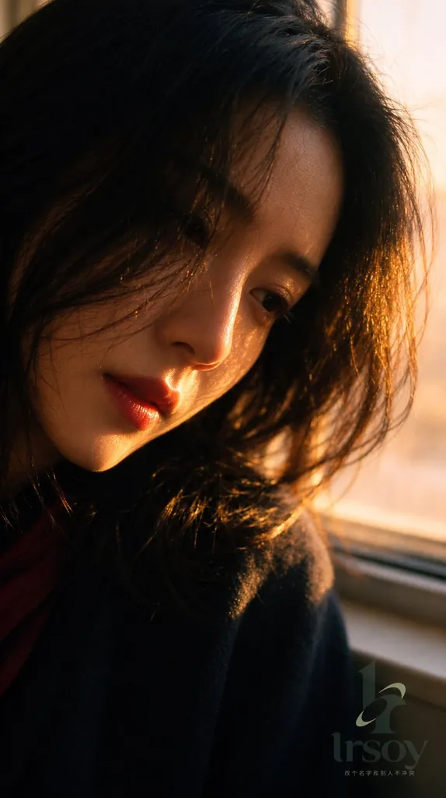

# Hair-Veiled Cinematic Close-Up — by @lrsoy_

[← Back to Community Examples](../../EXAMPLES.md) · Category: Photography · Model: `Seedream 5.0 Pro`

<a href="https://x.com/lrsoy_/status/2124470864502763793"></a>

Source: **[@lrsoy_ on X](https://x.com/lrsoy_/status/2124470864502763793)** · Creator: [lrsoy_](https://x.com/lrsoy_)

## Prompt

```text
9：16 一位成年东亚女性的电影感近距离人像特写，黑色中长发自然凌乱地垂落在脸侧，大量发丝遮住一侧眼睛和部分面部，头部微微向侧面倾斜，脸颊轻靠近肩膀，视线安静地看向镜头侧方，神情慵懒、克制、若有所思。 极近距离构图，以脸部和头发为视觉中心，画面只保留部分肩颈与上半身，人物并非正对镜头，略带侧脸角度，鼻梁、嘴唇和下颌线被暖光勾勒出来。自然精致的五官，柔和肤质，保留真实皮肤纹理与细微毛孔，淡妆，柔和眼妆，自然睫毛，微微湿润有光泽的红润嘴唇。 穿着简约的深色针织或柔软质感服装，肩部附近隐约出现一小部分暗红色布料，服装不作为画面主体，重点突出脸部、发丝与光影。 室内靠窗环境，傍晚金色阳光从人物侧后方照入，强烈而柔和的暖色侧逆光，发丝边缘形成金黄色轮廓光，部分阳光穿过头发洒在脸颊、鼻尖和嘴唇上，背景是一片柔和的奶油橙色窗边光斑，明暗反差明显，脸部部分区域沉入柔和阴影。 cinematic portrait photography, intimate close-up, warm golden hour sunlight, soft backlight, rim light on hair, shallow depth of field, dreamy atmosphere, natural skin texture, subtle film grain, analog film look, soft highlight bloom, creamy bokeh, gentle halation, low contrast shadows, muted warm color grading, realistic photography, emotional portrait, delicate facial details, imperfect loose hair strands, candid moment, editorial photography, 85mm lens look, f/1.4, extremely shallow depth of field, focus on eyes and lips, soft foreground blur, vertical composition, high-end cinematic still, natural and understated beauty, no artificial studio lighting, no plastic skin, no over-retouching
```

## Try it

Paste the prompt into **[vinano.ai](https://vinano.ai?utm_source=github&utm_medium=readme&utm_campaign=awesome-image-video-prompts-updating&utm_content=x-page-try)** to generate your own version.

> The image and prompt belong to @lrsoy_ ([original post](https://x.com/lrsoy_/status/2124470864502763793)) and are shown here with credit for reference. Creators can ask for changes or removal by opening an issue.
