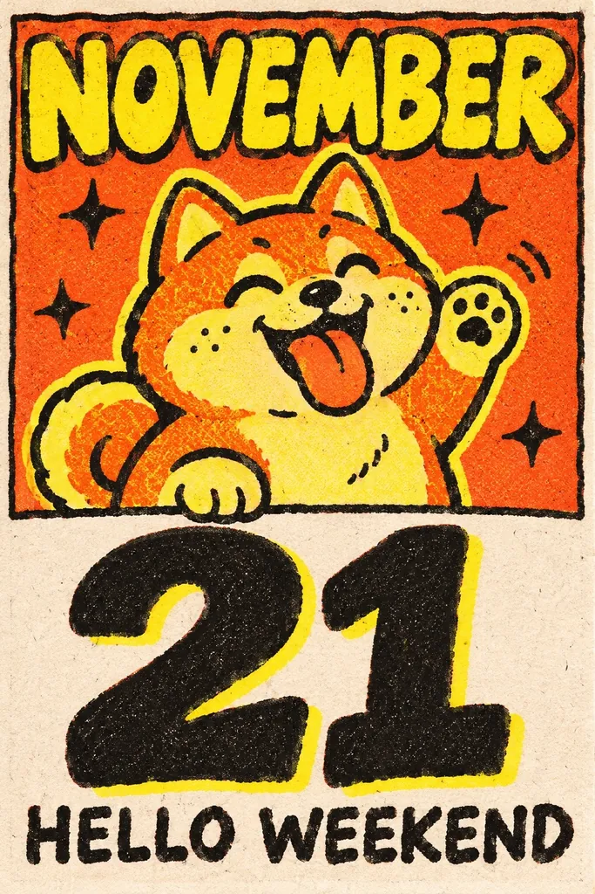

# Risograph Daily Calendar Card — by @static_stare

[← Back to Community Examples](../../EXAMPLES.md) · Category: Poster Design · Model: `GPT Image 2.5`

<a href="https://x.com/static_stare/status/2124075903554928681"></a>

Source: **[@static_stare on X](https://x.com/static_stare/status/2124075903554928681)** · Creator: [mo Ki](https://x.com/static_stare)

## Prompt

```text
Create an image with the following visual system. Replace the subject as specified.

Visual system (light, color, composition, medium, mood):
【画面风格】一张竖幅约 2:3 的复古孔版印刷（risograph）风日签卡片，整张卡片印在微微泛灰的米白厚纸上，四周留一圈纸边，纸面有细小纤维、油墨颗粒和网点，颜色之间有一点点套色错位。卡片上半部是一大块带粗黑手绘边框的橙红色色块，边框线条有点抖，像马克笔画的。色块最上方是一个超大的英文月份单词，胖胖的手绘大写字母，柠檬黄填色加粗黑描边，字母挤满一整行。色块中间是一个大大的卡通主角，粗黑描边、黑色平涂加少量柠檬黄和橙色填色，主角身后有一圈柠檬黄的轮廓光边，像贴纸一样把它从橙红底上托出来，表情夸张、有点搞怪，像 70 年代复古漫画里的角色；主角四周散落三四颗黑色的四角星。卡片下半部是米白纸底，正中是一个超大的日期数字，黑色粗体手绘数字，带一点柠檬黄的错位投影；数字下面是一行中等大小的黑色手写大写英文短句。整张只用橙红、柠檬黄、黑和米白纸四种颜色，线条粗，颜色饱和。卡片上只允许出现主体里指定的三处文字：月份单词、日期数字、一行短句，必须逐字照写、拼写正确、字母不多不少；不要日历格子、星期、签名、作者名、logo、品牌和其他任何字母或数字。

New subject:
【主体】月份单词：「NOVEMBER」。日期数字：「21」。短句：「HELLO WEEKEND」。主角：一只胖乎乎的柴犬，柠檬黄和橙色的毛，眼睛笑成两道弯，吐着舌头，举起一只前爪打招呼。全图只有这三处文字。
```

## Try it

Paste the prompt into **[vinano.ai](https://vinano.ai?utm_source=github&utm_medium=readme&utm_campaign=awesome-image-video-prompts-updating&utm_content=x-page-try)** to generate your own version.

> The image and prompt belong to @static_stare ([original post](https://x.com/static_stare/status/2124075903554928681)) and are shown here with credit for reference. Creators can ask for changes or removal by opening an issue.
