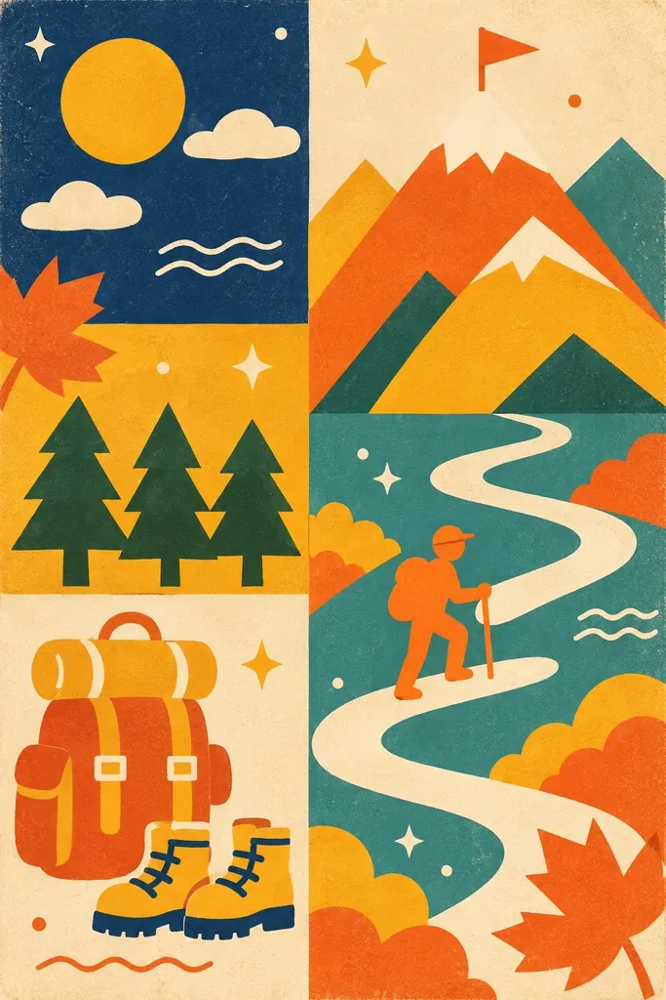

# Flat Geometric Autumn Hike Panels — by @static_stare

[← Back to Community Examples](../../EXAMPLES.md) · Category: Poster Design · Model: `GPT Image 2.5`

<a href="https://x.com/static_stare/status/2123998701295489519"></a>

Source: **[@static_stare on X](https://x.com/static_stare/status/2123998701295489519)** · Creator: [mo Ki](https://x.com/static_stare)

## Prompt

```text
Create an image with the following visual system. Replace the subject as specified.

Visual system (light, color, composition, medium, mood):
【画面风格】一张竖幅约 2:3 的扁平几何插画海报，像复古丝网印刷的度假海报，纸面有细微颗粒和一点做旧，所有颜色都是不透明的平涂色块，没有渐变、没有描边、没有立体阴影。整张画面被几条干脆的横竖直线切成清清楚楚的五六块格子，像拼布或一页拼贴，有方格也有一两块边缘是大弧线或波浪线的面板，每块格子背景色不同、画的内容互相独立，不是一张连续的风景：有的面板是暖橙底，有的是芥末黄底，有的是米白底，有一两块是湖青和深海军蓝。每块面板里只放一两个和主题有关的简化图形，图形像剪纸剪出来的扁平剪影，圆润、几何化，大小对比明显，有的图形会跨过面板边界；空白处零散点缀小圆点、小星星、四角星和米白色的细波浪线，像装饰碎花。色彩严格限制为暖橙、芥末黄、米白、湖青、深海军蓝，外加一点墨绿给植物，暖色占六成以上，冷色面板压住画面。光感是白天那种明亮、暖洋洋的感觉，但不画真实光影。整体轻快、热闹、松弛。画面里的人只画成没有五官的小剪影；不要文字、字母、数字、签名和水印。

New subject:
【主体】主题是秋天去爬山。面板里分别放：层层叠叠的三角形山峰，最高的山顶插着一面小三角旗；一排圆锥形的墨绿松树；一个鼓鼓的登山背包和一双登山靴；一条之字形往上绕的米白色山路，路上一个背包的小剪影；天空那块面板里一个圆太阳和两朵扁扁的云。
```

## Try it

Paste the prompt into **[vinano.ai](https://vinano.ai?utm_source=github&utm_medium=readme&utm_campaign=awesome-image-video-prompts-updating&utm_content=x-page-try)** to generate your own version.

> The image and prompt belong to @static_stare ([original post](https://x.com/static_stare/status/2123998701295489519)) and are shown here with credit for reference. Creators can ask for changes or removal by opening an issue.
