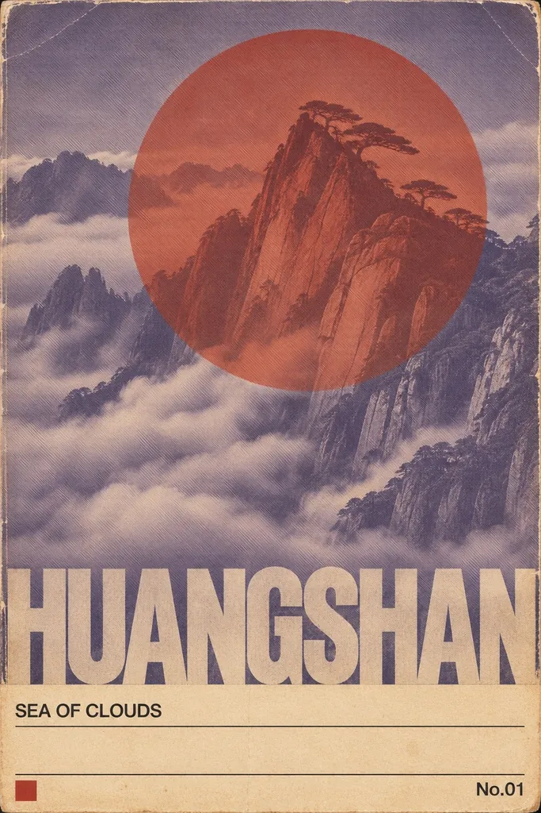

# Swiss Retro Travel Poster Huangshan — by @static_stare

[← Back to Community Examples](../../EXAMPLES.md) · Category: Poster Design · Model: `GPT Image 2.5`

<a href="https://x.com/static_stare/status/2124437182425518275"></a>

Source: **[@static_stare on X](https://x.com/static_stare/status/2124437182425518275)** · Creator: [mo Ki](https://x.com/static_stare)

## Prompt

```text
Create an image with the following visual system. Replace the subject as specified.

Visual system (light, color, composition, medium, mood):
【画面风格】一张竖幅约 2:3 的 70 年代瑞士国际主义风格复古旅行海报，像一张旧印刷品被扫描下来。画面上面约四分之三是一张风景照片，照片被处理成偏冷的紫灰蓝色调，暗部发紫、亮部泛米黄，像褪色的印刷照片，整张照片上覆着一层细密的斜向印刷网线和纸张颗粒。照片里最主要的那座山或景物正好被一个巨大的半透明砖红色正圆压住，圆形像透明色片叠印在照片上，圆里面的景物还看得清，被染成暖红棕色，圆的边缘干净。海报下方约四分之一是一条泛旧的米黄色纸底横带，横带和照片交界处，照片底部压着一行超大号、字间很紧的粗体无衬线大写英文地名标题，字是灰米色，几乎和海报一样宽。标题下面的米黄横带里，只在左侧有一行小号黑色无衬线大写英文短句，在右下角有一个小号黑色编号；横带里其余地方留白，只用两三条细细的黑色横线分隔，再放一个小小的砖红色实心方块作为装饰，方块里什么都没有。整张只用紫灰蓝、米黄、砖红、灰米和黑几种颜色，印刷颗粒均匀。海报上只允许出现主体里指定的三处文字：大标题地名、一行小字、一个编号，必须逐字照写、拼写正确、字母不多不少；不要成段的小字、说明文字栏、乱码字、国旗、十字、航空公司或任何品牌标志、logo、签名和水印。

New subject:
【主体】风景照片：花岗岩山峰从云海里冒出来，最高的那座峰顶尖尖的，峰顶崖边斜伸出几棵造型奇特的松树，下面是翻滚的白色云海。半透明砖红色圆压住最高的那座峰和松树。大标题：「HUANGSHAN」。一行小字：「SEA OF CLOUDS」。编号：「No.01」。全图只有这三处文字。
```

## Try it

Paste the prompt into **[vinano.ai](https://vinano.ai?utm_source=github&utm_medium=readme&utm_campaign=awesome-image-video-prompts-updating&utm_content=x-page-try)** to generate your own version.

> The image and prompt belong to @static_stare ([original post](https://x.com/static_stare/status/2124437182425518275)) and are shown here with credit for reference. Creators can ask for changes or removal by opening an issue.
