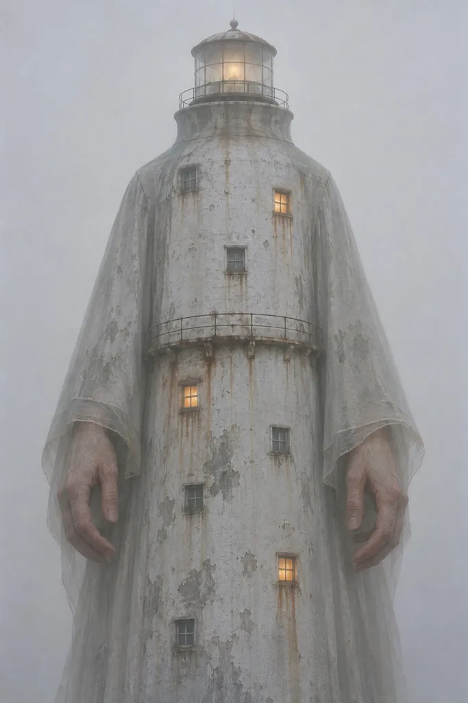

# Lighthouse Giant in the Fog — by @static_stare

[← Back to Community Examples](../../EXAMPLES.md) · Category: Photography · Model: `GPT Image 2.5`

<a href="https://x.com/static_stare/status/2124407068438450466"></a>

Source: **[@static_stare on X](https://x.com/static_stare/status/2124407068438450466)** · Creator: [mo Ki](https://x.com/static_stare)

## Prompt

```text
Create an image with the following visual system. Replace the subject as specified.

Visual system (light, color, composition, medium, mood):
【画面风格】一张竖幅约 2:3 的超现实主义概念摄影，像一张真实拍下的胶片照片。画面正中是一座又高又窄、正面平视的老建筑或大物件，它的整体轮廓被做成一件巨人穿着的长袍：上方收成一个高领口，两边是削下来的肩线，两条宽大的袖子顺着建筑两侧垂下来，袖口处各伸出一只比例巨大、非常写实的人手，手指自然微曲，皮肤有真实的褶皱和血色；领口上方是巨人的头，但头只是一截没有五官、没有脸的光滑圆柱，和建筑同一种材质。注意不是给建筑披了一块布：建筑的外墙本身就是这件长袍，墙面平直、硬挺，窗户和结构排列整齐、透视端正，只有两侧袖子和衣摆的外缘是一层很薄、略透的布边；建筑本身的材质、窗户、栏杆、斑驳的水渍和锈迹全都保留，像一件衣服的花纹印在巨人身上，衣摆一直延伸到画面底部被裁掉。背景是一整片均匀的雾天灰白天空，没有地平线、没有别的建筑，雾气让建筑边缘稍稍发软。光线是阴天柔和的漫射光，没有明显方向和硬阴影，整体色调低饱和、偏冷的灰白和水泥灰，唯一的暖色是建筑上零星几扇亮着橘黄色暖灯的窗户，暖灯在冷灰里很跳。质感是中画幅胶片：细细的颗粒、略微褪色的对比、真实的混凝土和金属表面细节。构图对称、居中，建筑占画面高度的九成，四周留一点雾；画面满幅，没有胶片边框、黑边、白边或片孔。气氛安静、怪诞、有点孤独。画面里不要文字、招牌、标志、数字、签名和水印。

New subject:
【主体】这座建筑是一座海边的老灯塔：白漆圆柱塔身已经斑驳发灰，一道道锈水痕往下流，塔身上下错落着几扇小方窗，其中三扇亮着橘黄暖灯，中段有一圈生锈的铁栏杆环廊像一条腰带；领口上方的圆柱头是灯塔顶上的玻璃灯室，玻璃里透出一点暖黄的光。
```

## Try it

Paste the prompt into **[vinano.ai](https://vinano.ai?utm_source=github&utm_medium=readme&utm_campaign=awesome-image-video-prompts-updating&utm_content=x-page-try)** to generate your own version.

> The image and prompt belong to @static_stare ([original post](https://x.com/static_stare/status/2124407068438450466)) and are shown here with credit for reference. Creators can ask for changes or removal by opening an issue.
