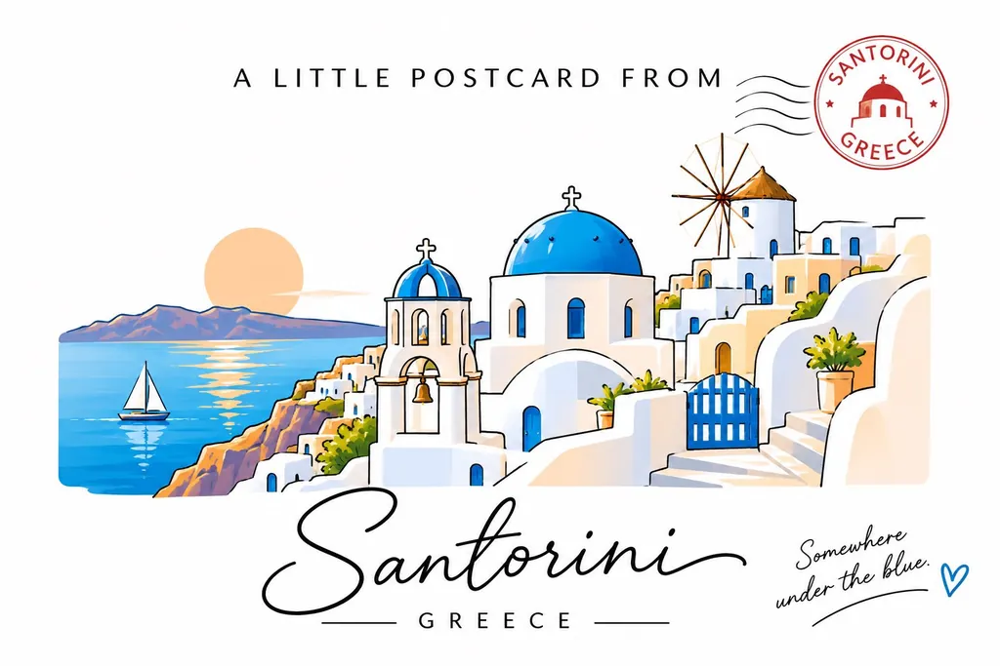

# Cute Watercolor Travel Postcard Template — by @Naiknelofar788

[← Back to Community Examples](../../EXAMPLES.md) · Category: Illustration & 3D · Model: `GPT Image 2.6`

<a href="https://x.com/Naiknelofar788/status/2124723328414048351"></a>

Source: **[@Naiknelofar788 on X](https://x.com/Naiknelofar788/status/2124723328414048351)** · Creator: [simeon-sanai](https://x.com/Naiknelofar788)

## Prompt

```text
Create an exceptionally cute, charming and minimalist illustrated travel postcard featuring [CITY], [COUNTRY].
ART STYLE & COMPOSITION
A clean, bright white postcard background with a delicate hand-drawn illustration of 4–6 iconic landmarks arranged side by side along a simple horizontal baseline.
Include the most recognisable architectural landmarks of the destination, illustrated in a playful, slightly imperfect sketch style with fine black outlines, soft pastel watercolour fills and charming architectural details.
Keep the landmarks simple, recognisable, colourful and beautifully balanced, almost like a little illustrated travel diary.
COLOUR PALETTE
Use gentle, cheerful pastel shades inspired by the destination. Soft lavender, peach, butter yellow, powder blue, blush pink and muted coral. Every city should have its own distinctive colour combination.
TYPOGRAPHY
At the top, write:
A LITTLE POSTCARD FROM
At the bottom, feature the city name in beautiful flowing handwritten script.
THE LITTLE THOUGHT — SIGNATURE DETAIL
Place one tiny handwritten sentence in a bottom corner, almost like a personal travel journal note.

Keep this thought small, subtle and intimate.
FINAL LOOK
Airy composition, generous white negative space, delicate imperfect ink lines, soft pastel illustrations, whimsical charm and a lovely handmade postcard aesthetic.
Vertical 4:5 format. Elegant, cute, minimal, nostalgic and timeless.
No realistic photography, no heavy backgrounds, no excessive decorations, no unnecessary flowers, no clutter, no 3D effects.
```

## Try it

Paste the prompt into **[vinano.ai](https://vinano.ai?utm_source=github&utm_medium=readme&utm_campaign=awesome-image-video-prompts-updating&utm_content=x-page-try)** to generate your own version.

> The image and prompt belong to @Naiknelofar788 ([original post](https://x.com/Naiknelofar788/status/2124723328414048351)) and are shown here with credit for reference. Creators can ask for changes or removal by opening an issue.
