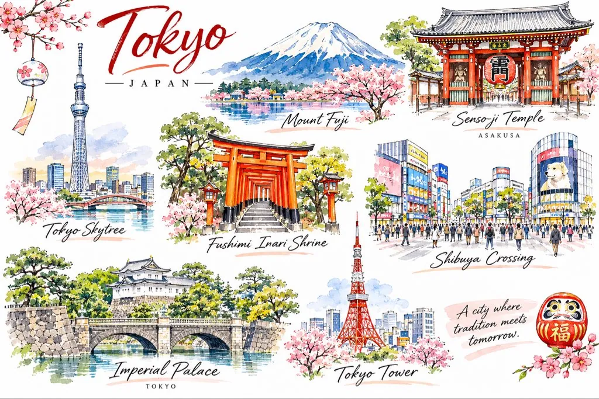

# Architectural Travel Sketch Collage Template — by @Naiknelofar788

[← Back to Community Examples](../../EXAMPLES.md) · Category: Illustration & 3D · Model: `GPT Image 2.6`

<a href="https://x.com/Naiknelofar788/status/2124843499841548545"></a>

Source: **[@Naiknelofar788 on X](https://x.com/Naiknelofar788/status/2124843499841548545)** · Creator: [simeon-sanai](https://x.com/Naiknelofar788)

## Prompt

```text
Create an exquisite hand-illustrated architectural travel sketch collage featuring the most iconic landmarks of [CITY], [COUNTRY].

1. COMPOSITION

Arrange 5–7 separate landmark illustrations across a spacious, pure white background. Each landmark should appear as an independent hand-drawn vignette, distributed organically like a beautiful page from an artist’s travel journal.

Vary the scale, angle and perspective of each illustration. Leave generous white space between the sketches.

2. LANDMARKS WITH THEIR NAMES

Include these specific locations, accurately illustrated and individually labelled:

[LANDMARK 1] — [NAME]
Write the correct landmark name directly beneath or beside each illustration in elegant, delicate handwritten lettering.

3. ILLUSTRATION STYLE

Fine architectural pen sketches combined with loose watercolor washes.

Use delicate black and grey outlines, subtle pencil strokes, soft imperfect ink details and gentle watercolor fills.

Capture authentic architectural details, distinctive silhouettes, surrounding gardens, fountains, streets and geographical features.

4. COLOUR PALETTE

Use a sophisticated destination-inspired palette. Muted terracotta, warm beige, dusty sage green, faded blue, soft ochre and subtle rose.

Colours should look naturally brushed onto textured paper rather than digitally filled.

5. SPECIAL DETAILS

Include one small cultural symbol or iconic emblem associated with the destination.

At the top, write the city name in elegant vintage calligraphy.

Add a tiny handwritten travel-inspired phrase near the bottom.

6. FINAL PRESENTATION

An elegant illustrated travel atlas page, museum-quality architectural sketchbook, vintage European travel journal aesthetic, delicate watercolor and ink technique.

Landscape 3:2 composition, clean white background, sophisticated artistic balance, beautiful negative space.

No photographs, no 3D rendering, no heavy borders, no clutter, no incorrect landmark architecture.

Ensure every landmark label is correctly spelled and clearly readable.
```

## Try it

Paste the prompt into **[vinano.ai](https://vinano.ai?utm_source=github&utm_medium=readme&utm_campaign=awesome-image-video-prompts-updating&utm_content=x-page-try)** to generate your own version.

> The image and prompt belong to @Naiknelofar788 ([original post](https://x.com/Naiknelofar788/status/2124843499841548545)) and are shown here with credit for reference. Creators can ask for changes or removal by opening an issue.
