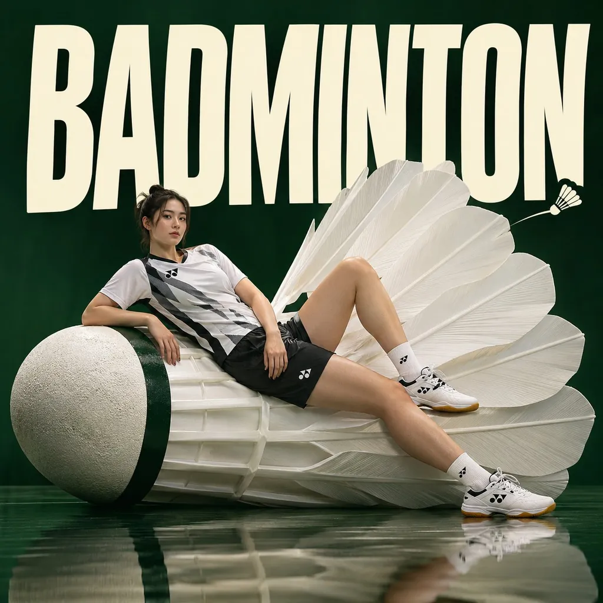

# Giant Shuttlecock Badminton Fashion Ad — by @Goodmanprotocol

[← Back to Community Examples](../../EXAMPLES.md) · Category: Poster Design · Model: `GPT Image 2.6`

<a href="https://x.com/Goodmanprotocol/status/2124756790143488011"></a>

Source: **[@Goodmanprotocol on X](https://x.com/Goodmanprotocol/status/2124756790143488011)** · Creator: [Saul Goodman](https://x.com/Goodmanprotocol)

## Prompt

```text
BADMINTON | AVANT-GARDE SPORTS FASHION ADVERTISING CAMPAIGN

Create an extraordinary, high-end avant-garde sports fashion advertisement that blends professional badminton, surrealist sculpture and luxury editorial photography. The central element is a gigantic badminton shuttlecock, dramatically enlarged and designed as a monumental sculptural installation, resembling an oversized piece of contemporary designer furniture.

1. ATHLETE & POSE

Feature a female professional badminton athlete casually reclining across the curved surface of the enormous shuttlecock. Her pose should feel effortless, confident and fashion-forward, with one arm naturally supporting her upper body and her legs positioned elegantly across the sculpture. Maintain realistic human proportions, natural body positioning and authentic athletic posture. She wears a stylish professional badminton outfit consisting of a modern sports jersey, black athletic shorts, white sports socks and premium badminton court shoes. Her overall appearance should communicate the confidence and elegance of a luxury sportswear campaign.

2. SHUTTLECOCK SCULPTURE

Make the oversized badminton shuttlecock the dominant architectural feature of the composition. Its rounded cork head should have a refined, slightly textured surface, while its large white feathered structure should extend outward in a dramatic, sculptural arrangement. Incorporate realistic feather details, subtle shadows and carefully crafted proportions. The athlete should appear naturally integrated into the sculpture, as though reclining on an extraordinary piece of contemporary furniture.

3. TYPOGRAPHY & GRAPHIC DESIGN

Position the enormous word "BADMINTON" prominently across the upper background in bold, oversized, condensed uppercase typography. Use a warm ivory or cream-white color with a powerful editorial presence. The lettering should be clean, sharp and highly legible, creating a strong visual identity without competing with the athlete. Include a small, subtle badminton shuttlecock graphic near the typography as a complementary design detail.

4. ENVIRONMENT & BACKGROUND

Set the entire composition inside a sophisticated deep burnt-green studio with a rich forest-green backdrop. The environment should feel like a premium advertising photography studio rather than a conventional badminton court. Use a highly polished, glossy mirrored floor that produces beautiful reflections of the athlete, shuttlecock sculpture and studio lighting. Keep the background minimal and uncluttered to emphasize the monumental installation.

5. LIGHTING & VISUAL AESTHETICS

Use cinematic studio lighting with carefully controlled highlights, soft directional shadows and subtle reflections. Illuminate the white shuttlecock sculpture to emphasize its textures and three-dimensional structure while maintaining beautiful skin tones and realistic fabric details. Introduce subtle atmospheric depth and sophisticated color grading for a polished luxury campaign appearance.

6. FINAL ART DIRECTION

The final image should resemble an internationally recognized luxury sportswear advertising campaign, combining avant-garde fashion photography, monumental product sculpture, surreal creative direction and contemporary graphic design. Maintain exceptional photorealism, precise anatomy, realistic materials, sophisticated composition and professional commercial photography quality.

OUTPUT: Square 1:1 aspect ratio, full-body athlete, oversized sculptural shuttlecock, dominant BADMINTON typography, balanced editorial composition, ultra-detailed textures, cinematic lighting, premium advertising finish. No watermark, no unnecessary objects, no distorted anatomy or artificial-looking details.
```

## Try it

Paste the prompt into **[vinano.ai](https://vinano.ai?utm_source=github&utm_medium=readme&utm_campaign=awesome-image-video-prompts-updating&utm_content=x-page-try)** to generate your own version.

> The image and prompt belong to @Goodmanprotocol ([original post](https://x.com/Goodmanprotocol/status/2124756790143488011)) and are shown here with credit for reference. Creators can ask for changes or removal by opening an issue.
