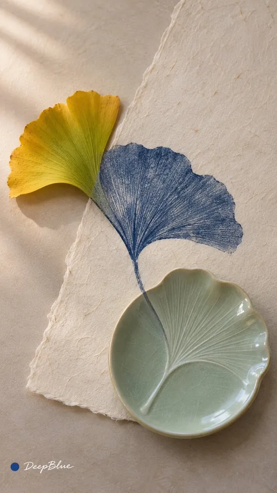

# One Object, Three Forms Nature Specimen — by @octopusaia

[← Back to Community Examples](../../EXAMPLES.md) · Category: Photography · Model: `GPT Image`

<a href="https://x.com/octopusaia/status/2124823021395595334"></a>

Source: **[@octopusaia on X](https://x.com/octopusaia/status/2124823021395595334)** · Creator: [章鱼8̃爪铺🐙](https://x.com/octopusaia)

## Prompt

```text
《一物三藏》｜自然标本 × 跨媒介三相转译 × 东方实验艺术摄影。每张独立选择一种具有鲜明形态与纹理的自然原物，从植物、花果、菌类、贝壳、羽毛、矿石、化石或其他自然标本中自由抽取。围绕这件自然原物，自由选择一种艺术工艺与一件人工器物，利用原物的形态、纹理、色彩或结构，创造出人意料的跨媒介关联。可以探索接触显影、影子补形、轮廓接续、材料转化、平面与立体互换、光学错觉、时间留痕。让自然原物的本相、跨媒介留下的留相，以及令人意外的幻相形成巧妙互动，观众第一眼看懂主角，第二眼发现令人惊喜的细节。每张自由设计三相关系、材料、工艺、构图、观看方式与场景。鼓励诗意、幽默、荒诞和意外发现，让创意自然融入可信的实体世界。融合东方极简美学与当代实验艺术摄影。真实 iPhone 原相机质感，自然光、准确曝光、干净暗部、低噪点、低 HDR、柔和真实的材料纹理。构图疏朗，主次分明，适当留白，保持清爽通透的视觉质感。9:16 直式独立单图，每张分别生成。
```

## Try it

Paste the prompt into **[vinano.ai](https://vinano.ai?utm_source=github&utm_medium=readme&utm_campaign=awesome-image-video-prompts-updating&utm_content=x-page-try)** to generate your own version.

> The image and prompt belong to @octopusaia ([original post](https://x.com/octopusaia/status/2124823021395595334)) and are shown here with credit for reference. Creators can ask for changes or removal by opening an issue.
