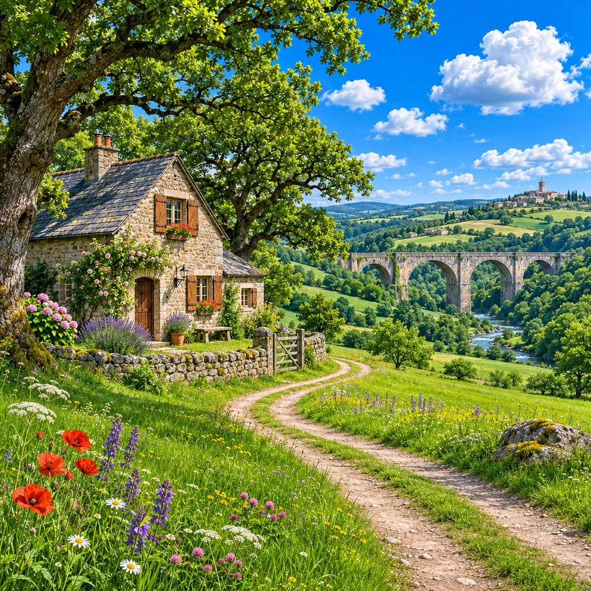

# Idyllic European Countryside Landscape — by @DavidLi36143625

[← Back to Community Examples](../../EXAMPLES.md) · Category: Photography · Model: `GPT Image 2.6 Sunburst`

<a href="https://x.com/DavidLi36143625/status/2124791472793002466"></a>

Source: **[@DavidLi36143625 on X](https://x.com/DavidLi36143625/status/2124791472793002466)** · Creator: [David Liang](https://x.com/DavidLi36143625)

## Prompt

```text
A picturesque European countryside landscape in a 1:1 square composition, featuring expansive, vivid, saturated green rolling fields and meadows dotted with wildflowers. In the midground, a charming rustic stone cottage with a pitched slate roof and wooden shutters nestles beside a cluster of leafy oak trees along a winding dirt path. Far in the distance, a grand, weathered stone bridge with tall rounded arches spans across a lush valley. Above, a bright, vibrant blue sky stretches high with scattered, fluffy white cumulus clouds. Bathed in crisp, bright natural sunlight, the scene evokes an idyllic, peaceful mood with rich, saturated colors, sharp details, and balanced depth from the grassy foreground to the distant horizon.
```

## Try it

Paste the prompt into **[vinano.ai](https://vinano.ai?utm_source=github&utm_medium=readme&utm_campaign=awesome-image-video-prompts-updating&utm_content=x-page-try)** to generate your own version.

> The image and prompt belong to @DavidLi36143625 ([original post](https://x.com/DavidLi36143625/status/2124791472793002466)) and are shown here with credit for reference. Creators can ask for changes or removal by opening an issue.
