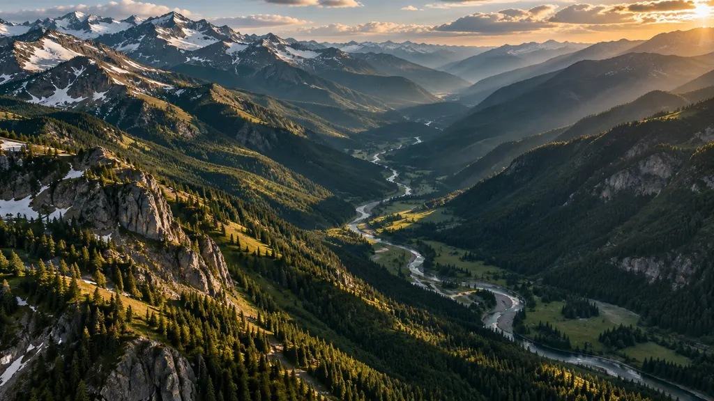

# Aerial Mountain Valley Flyover Still — by @DavidLi36143625

[← Back to Community Examples](../../EXAMPLES.md) · Category: Photography · Model: `GPT Image 2.6 Sunburst`

<a href="https://x.com/DavidLi36143625/status/2124707415811911699"></a>

Source: **[@DavidLi36143625 on X](https://x.com/DavidLi36143625/status/2124707415811911699)** · Creator: [David Liang](https://x.com/DavidLi36143625)

## Prompt

```text
A cinematic aerial flyover shot, 16:9 aspect ratio, over a vast mountain valley. The camera looks down at a steep angle, layered ridges receding into haze, a river winding through the valley floor far below. Pine forests darken the slopes, patches of snow on the highest peaks. Late afternoon sunlight rakes across the terrain, casting long shadows in the folds of the land. Photorealistic, natural light, high detail.
```

## Try it

Paste the prompt into **[vinano.ai](https://vinano.ai?utm_source=github&utm_medium=readme&utm_campaign=awesome-image-video-prompts-updating&utm_content=x-page-try)** to generate your own version.

> The image and prompt belong to @DavidLi36143625 ([original post](https://x.com/DavidLi36143625/status/2124707415811911699)) and are shown here with credit for reference. Creators can ask for changes or removal by opening an issue.
