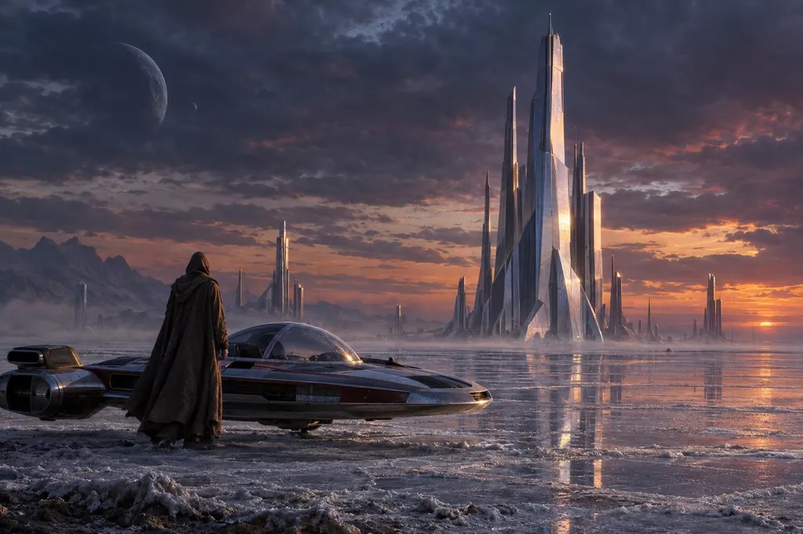

# Alien Salt Plain with Chrome Towers — by @Yeti_Images

[← Back to Community Examples](../../EXAMPLES.md) · Category: Illustration & 3D · Model: `GPT Image 2.5 Flare`

<a href="https://x.com/Yeti_Images/status/2125024098094878909"></a>

Source: **[@Yeti_Images on X](https://x.com/Yeti_Images/status/2125024098094878909)** · Creator: [Yeti Images](https://x.com/Yeti_Images)

## Prompt

```text
A vast, windswept salt plain on an alien world stretches beneath a bruised dusk sky, where Ralph McQuarrie-inspired angular white-and-chrome towers rise from the ground like geometric crystals, their surfaces catching the last light; in the foreground, a lone robed figure stands beside a sleek, bubble-canopied landspeeder, both rendered with cinematic depth, atmospheric haze, and photorealistic digital painting texture.
```

## Try it

Paste the prompt into **[vinano.ai](https://vinano.ai?utm_source=github&utm_medium=readme&utm_campaign=awesome-image-video-prompts-updating&utm_content=x-page-try)** to generate your own version.

> The image and prompt belong to @Yeti_Images ([original post](https://x.com/Yeti_Images/status/2125024098094878909)) and are shown here with credit for reference. Creators can ask for changes or removal by opening an issue.
