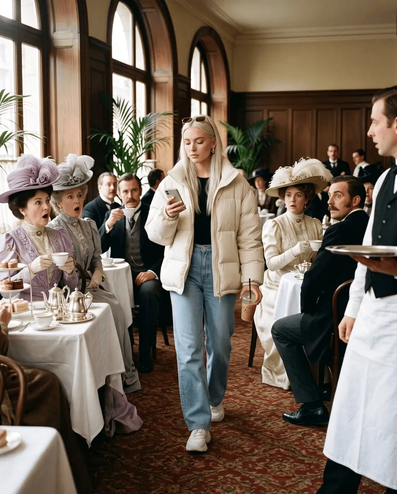

# Edwardian Tea Salon Time Traveller — by @aiartalley

[← Back to Community Examples](../../EXAMPLES.md) · Category: Photography · Model: `Nano Banana 2.1`

<a href="https://x.com/aiartalley/status/2124880820208914677"></a>

Source: **[@aiartalley on X](https://x.com/aiartalley/status/2124880820208914677)** · Creator: [AI Art Alley](https://x.com/aiartalley)

## Prompt

```text
A candid everyday colour photograph inside an Edwardian tea salon around 1905, taken from a seated guest's eye height across the room and slightly off level. Walking in down the aisle between the tables comes a time traveller, a Northern European woman in her early twenties with long straight platinum-blonde hair, light skin, natural modern makeup and small gold hoop earrings, small rectangular sunglasses pushed up on her head, an oversized cream puffer jacket hanging open over a fitted black top, wide-leg light-blue jeans and chunky white sneakers, a phone in her right hand and a takeaway iced coffee in a clear plastic cup with a straw in her left, her eyes down on the phone screen and her stride loose and unbothered. Around her the room has stopped. At the table to her left two ladies in high-collared long dresses of lilac and dove grey under large feathered hats hold their teacups halted mid-air by the handles, mouths open, and behind them a moustached gentleman in a frock coat and waistcoat sits bolt upright with his cup frozen at his chin. At the table to her right a lady in an ivory high-collared gown and a broad feathered hat and a moustached gentleman in a dark frock coat both twist round in their chairs, eyebrows high and eyes wide. In the near foreground at the right a waiter in a long white apron holds a silver tray level, his shoulder cut by the frame edge, his head turned toward her and his jaw slack. Every face is natural and individual and every hand rests naturally on a cup, a saucer or the tray. Tall arched windows along the left wall rise to the ceiling and let soft warm daylight fall across the room from the left, laying gentle shadows to the right of each chair and figure. Potted palms stand between the windows, white tablecloths carry silver tea services and tiered cake stands of small cakes, the walls are dark wood panelling and the floor is a patterned carpet of deep red and gold. The period room and its people are fully real and rendered in the same natural full colour as she is, so the difference between the eras lives only in clothes, hair and posture: everyone of 1905 rigid and turned toward her, she the only person in motion.
```

## Try it

Paste the prompt into **[vinano.ai](https://vinano.ai?utm_source=github&utm_medium=readme&utm_campaign=awesome-image-video-prompts-updating&utm_content=x-page-try)** to generate your own version.

> The image and prompt belong to @aiartalley ([original post](https://x.com/aiartalley/status/2124880820208914677)) and are shown here with credit for reference. Creators can ask for changes or removal by opening an issue.
