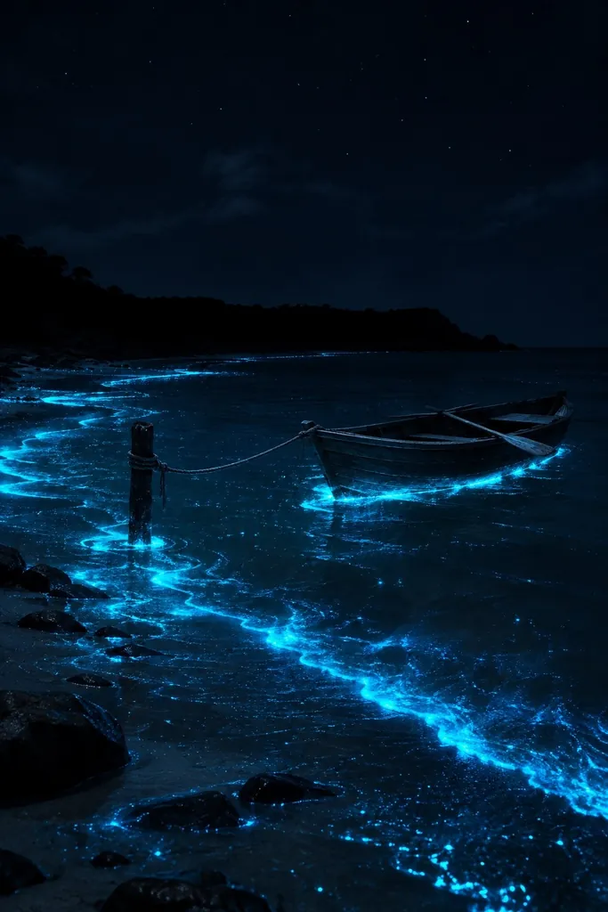

# Bioluminescent Shore Long Exposure — by @static_stare

[← Back to Community Examples](../../EXAMPLES.md) · Category: Photography · Model: `GPT Image 2.5`

<a href="https://x.com/static_stare/status/2124868443916865688"></a>

Source: **[@static_stare on X](https://x.com/static_stare/status/2124868443916865688)** · Creator: [mo Ki](https://x.com/static_stare)

## Prompt

```text
Create an image with the following visual system. Replace the subject as specified.

Visual system (light, color, composition, medium, mood):
【画面风格】一张竖幅约 2:3 的夜景风光摄影，像在没有月亮的深夜用相机长曝光拍下的真实照片，画面有轻微的高感光噪点。整张画面沉在深海军蓝和接近黑色的暗部里，唯一的亮光来自水里的生物荧光：浪花、水花或被扰动的水面发出电光一样的亮青蓝色光，越靠近浪尖和被扰动的地方越亮，接近白青色，再向外散成无数细小的蓝色光点，像撒了一层碎星。发光的水从画面前景斜着向远处铺开，形成一道弯曲的引导线，水里的光点在长曝光下略带拖尾，水和岸、水和物体交界的边缘是一圈最亮的荧光描边。其余地方几乎全黑：天空从深蓝渐变到墨黑，只有稀疏的小星点和几团被微光勾出轮廓的暗云，不要银河，不要月亮；远处的陆地、树和礁石只剩黑色剪影。前景近处的沙地、石头或木头被荧光照出一点冷蓝色的反光细节。整体只有黑、深海军蓝、电光青蓝和极少量白青高光，没有暖色。低机位，留出大面积暗部，安静、空旷，像只听得到水声。画面里不要人、不要人造灯光，不要文字、签名和水印。

New subject:
【主体】一条没人的小木划艇停在浅湾里，用一根绳子系在水里的木桩上，船底一圈的水发着蓝光，船桨搁在船舷上；远处是一道黑色的低矮岬角。
```

## Try it

Paste the prompt into **[vinano.ai](https://vinano.ai?utm_source=github&utm_medium=readme&utm_campaign=awesome-image-video-prompts-updating&utm_content=x-page-try)** to generate your own version.

> The image and prompt belong to @static_stare ([original post](https://x.com/static_stare/status/2124868443916865688)) and are shown here with credit for reference. Creators can ask for changes or removal by opening an issue.
