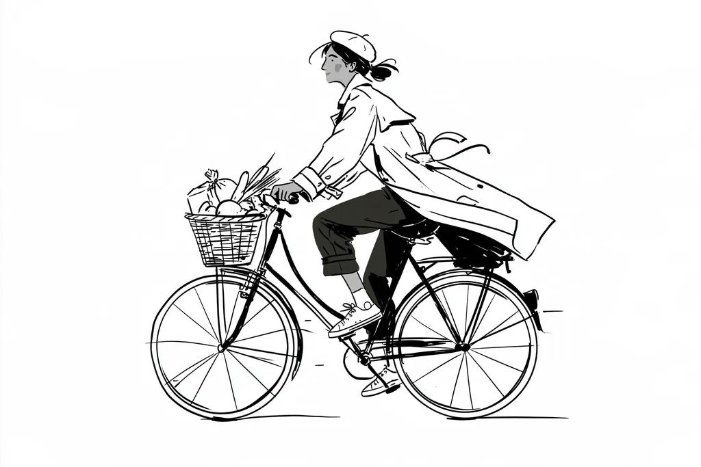

# Minimalist Black Ink Illustration Template — by @octopusaia

[← Back to Community Examples](../../EXAMPLES.md) · Category: Illustration & 3D · Model: `GPT Image`

<a href="https://x.com/octopusaia/status/2124942135468466328"></a>

Source: **[@octopusaia on X](https://x.com/octopusaia/status/2124942135468466328)** · Creator: [章鱼8̃爪铺🐙](https://x.com/octopusaia)

## Prompt

```text
A minimalist black ink illustration of [subject] [performing action], wearing [outfit], clean expressive brushstrokes, varied line thickness, relaxed natural posture, simplified facial features, selective solid black shapes, minimal activity-related props, elegant hand-drawn aesthetic, contemporary editorial illustration, generous negative space, no shading, monochrome ink on a clean white background
```

## Try it

Paste the prompt into **[vinano.ai](https://vinano.ai?utm_source=github&utm_medium=readme&utm_campaign=awesome-image-video-prompts-updating&utm_content=x-page-try)** to generate your own version.

> The image and prompt belong to @octopusaia ([original post](https://x.com/octopusaia/status/2124942135468466328)) and are shown here with credit for reference. Creators can ask for changes or removal by opening an issue.
