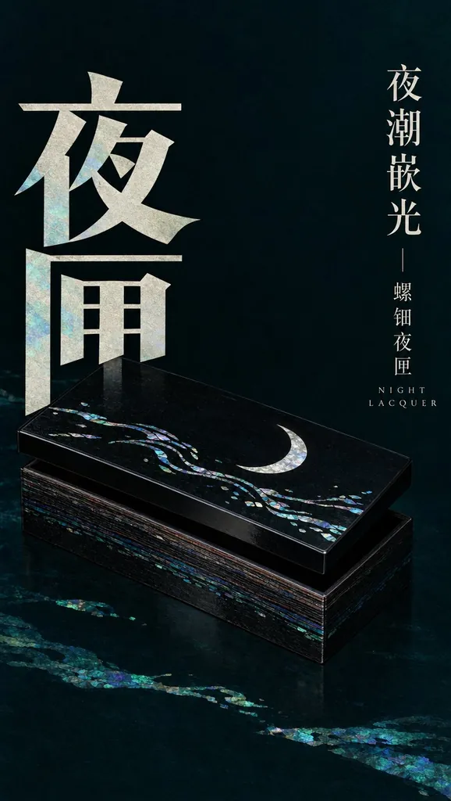

# Mother-of-Pearl Lacquer Box Exhibition Poster — by @Andy4aicreate

[← Back to Community Examples](../../EXAMPLES.md) · Category: Poster Design · Model: `GPT Image 2.5 Flare`

<a href="https://x.com/Andy4aicreate/status/2124934011592085845"></a>

Source: **[@Andy4aicreate on X](https://x.com/Andy4aicreate/status/2124934011592085845)** · Creator: [Andy](https://x.com/Andy4aicreate)

## Prompt

```text
请创作一张九比十六竖版、具有专业设计工作室水准的当代东方文化艺术展览海报。

展览主题：夜潮嵌光。中文主标题：螺钿夜匣。英文主标题：NIGHT LACQUER。核心艺术对象是一只完全虚构的长方形黑漆螺钿匣，匣盖微微掀开，盖面用螺钿镶出一弯冷白新月和几道细碎浪纹，匣身侧面露出细密的漆层断面，没有文字、纹章或可辨认的器物款识。

字体表现：画面左侧重叠两枚巨大的几何感汉字「夜匣」，笔画粗实，部分笔划被漆匣遮挡或从匣盖后方穿过；右侧以细长的纵向粗宋体排布展览主题，字距疏朗。不出现机构名、商标或网址。

背景为深海青与近黑的漆色，局部有螺钿特有的蓝绿虹彩。构图平稳，留出足够的边缘留白，印刷质感清晰，文字必须逐字正确。不出现真实人物、摄影写真、三维渲染或水印。
```

## Try it

Paste the prompt into **[vinano.ai](https://vinano.ai?utm_source=github&utm_medium=readme&utm_campaign=awesome-image-video-prompts-updating&utm_content=x-page-try)** to generate your own version.

> The image and prompt belong to @Andy4aicreate ([original post](https://x.com/Andy4aicreate/status/2124934011592085845)) and are shown here with credit for reference. Creators can ask for changes or removal by opening an issue.
