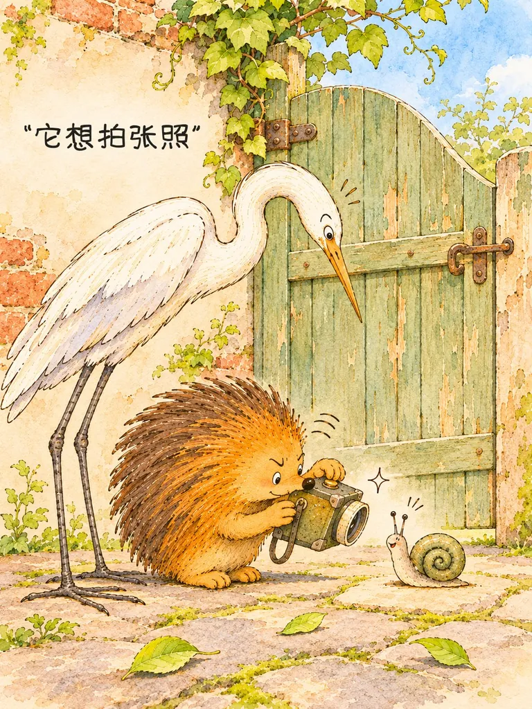

# Hedgehog, Egret and Snail Picture Book Page — by @Leviwoyun

[← Back to Community Examples](../../EXAMPLES.md) · Category: Illustration & 3D · Model: `GPT Image 2.6`

<a href="https://x.com/Leviwoyun/status/2125060880778104908"></a>

Source: **[@Leviwoyun on X](https://x.com/Leviwoyun/status/2125060880778104908)** · Creator: [Levi 卧云](https://x.com/Leviwoyun)

## Prompt

```text
绘制一张竖版 3:4 的原创儿童绘本插画。用透明水彩和深褐色细墨线画在暖象牙色水彩纸上。线条有轻重，偶尔断开。颜色自然铺开，在砖缝、叶缘和轮廓转角处留少量积色和水痕。用几根短排线顺着背刺和羽毛的方向画出结构，明亮处露出纸底。

画面明快、温暖，像一页能单独讲清一个动作的绘本。主色用植物绿、赭黄、陶砖红和浅天蓝。每页挑两三种主色，按场景调轻重。近处的笔触清楚，远处用较淡的水彩收住。道具和植物靠画面边缘生长，角色的脸、爪尖和关键物件之间留出干净的空隙。

角色靠轮廓和动作辨认。刺猬矮胖，赭黄的脸、深褐色的背刺、短爪和黑圆鼻子。白鹭身体修长，白翅、细黑腿、长黄嘴，脖子能弯出夸张的 S 形。蜗牛最小，灰橄榄色的软身、两根细触角和一只深色螺旋壳。表情有一点认真过头的可爱，用视线、歪头和姿势把笑点画出来。

一页只画一个主要动作。连页沿用同一批角色的轮廓、比例和关键道具，用全景、低视角、局部特写轮换讲故事。排除光滑的矢量轮廓、塑料光泽、厚重油画质感和满页均匀的细节。

本页场景｜[地点、时间、两三样关键物件]
本页动作｜[谁正在做什么，另一个角色怎么反应]
本页镜头｜[全景／低视角／特写／俯视]

在画面一处浅色留白写下“[本页短句]”。用偏深褐的中文手写细墨线，加一对小小的手画双引号。整行排稳，单字内部保留轻微的弯折、挤压和不齐的收笔。在本页最重要的小物旁画一颗细线四角星。
```

## Try it

Paste the prompt into **[vinano.ai](https://vinano.ai?utm_source=github&utm_medium=readme&utm_campaign=awesome-image-video-prompts-updating&utm_content=x-page-try)** to generate your own version.

> The image and prompt belong to @Leviwoyun ([original post](https://x.com/Leviwoyun/status/2125060880778104908)) and are shown here with credit for reference. Creators can ask for changes or removal by opening an issue.
