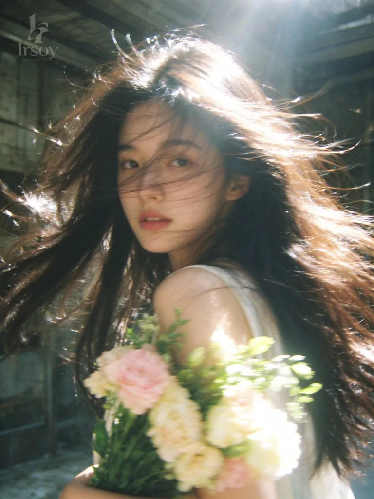

# Backlit Candid Portrait with Flowers — by @lrsoy_

[← Back to Community Examples](../../EXAMPLES.md) · Category: Photography · Model: `Seedream 5.0 Pro`

<a href="https://x.com/lrsoy_/status/2124417124622069772"></a>

Source: **[@lrsoy_ on X](https://x.com/lrsoy_/status/2124417124622069772)** · Creator: [lrsoy_](https://x.com/lrsoy_)

## Prompt

```text
一位年轻成年亚洲女性，长黑发自然披散，在强烈逆光下快速回头，头发被风吹起并随着动作向四周飞散，几缕发丝横过脸颊和眼睛，人物微微侧身回望镜头，神情自然、朦胧、略带疏离感。 她怀里抱着一束柔和的浅粉色、奶油白色鲜花和绿色枝叶，花束靠近胸前，穿浅色无袖或细肩带上衣，肩部和手臂被阳光照亮。 拍摄瞬间存在明显运动模糊，人物脸部不是完全锐利，五官轻微拖影，发丝因为快速移动形成柔和光轨，整体像真实相机抓拍到的瞬间。 强烈阳光从人物后上方照射，头发边缘形成非常明亮的金白色轮廓光，部分高光轻微过曝，产生明显 halation、光晕和泛白效果，画面边缘柔软。背景是昏暗的室内或半室外旧建筑环境，细节模糊、偏暗，与人物头发上的强光形成巨大明暗反差。 vintage candid portrait, photorealistic adult Asian woman, long black hair blowing in the wind, turning her head quickly, holding a bouquet of soft pink and cream flowers, strong backlight, glowing hair rim light, blown highlights, motion blur, slight camera shake, soft focus, dreamy overexposure, halation, shallow depth of field, spontaneous snapshot, analog photography, 35mm film look, low fidelity beauty, nostalgic atmosphere, imperfect photography, subtle film grain, warm faded tones, vertical composition
```

## Try it

Paste the prompt into **[vinano.ai](https://vinano.ai?utm_source=github&utm_medium=readme&utm_campaign=awesome-image-video-prompts-updating&utm_content=x-page-try)** to generate your own version.

> The image and prompt belong to @lrsoy_ ([original post](https://x.com/lrsoy_/status/2124417124622069772)) and are shown here with credit for reference. Creators can ask for changes or removal by opening an issue.
