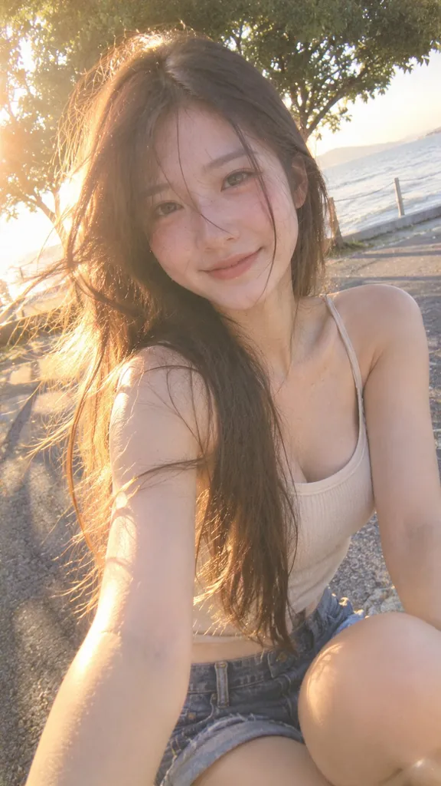

# Golden Backlit Hair at a Seaside Park — by @Adam38363368936

[← Back to Community Examples](../../EXAMPLES.md) · Category: Photography · Model: `GPT Image 2.6`

<a href="https://x.com/Adam38363368936/status/2124865921491841350"></a>

Source: **[@Adam38363368936 on X](https://x.com/Adam38363368936/status/2124865921491841350)** · Creator: [Adam也叫吉米](https://x.com/Adam38363368936)

## Prompt

```text
9:16竖版，超写实自然人像摄影，日系夏日胶片风格。

夏日黄昏的海边公园，一位二十多岁的清秀东亚女生坐在海边步道旁，深棕色及腰长发，自然蓬松，几缕碎发轻轻垂落脸颊。五官精致但自然，脸型柔和，眼神清澈，带着淡淡的羞涩微笑，气质干净温柔，具有真实生活中的少女感，避免千篇一律的AI网红脸。

皮肤白皙通透，保留真实毛孔、细小雀斑、自然肤色变化与细微瑕疵，面部有真实的光影起伏，不磨皮，不使用美颜滤镜，呈现自然健康的皮肤质感。

身穿米白色修身针织无袖背心与浅蓝色牛仔短裤，衣料柔软自然，布料纹理清晰，整体穿搭清爽简约。

人物自然坐在海边低矮石阶上，身体微微侧向镜头，上半身轻轻前倾，肩膀自然放松，双臂自然垂落，双手轻轻放在膝盖附近，不向镜头伸展。姿态松弛随意，仿佛朋友在散步时不经意拍下的一张照片。肩膀、手臂和躯干保持真实协调的人体比例，手臂长度正常，关节弯曲符合自然人体结构。

温暖明亮的夕阳从人物身后左侧斜射而来，形成通透柔和的金色逆光。阳光穿过蓬松的长发，让每一缕发丝边缘都泛起细腻明亮的金色光晕，形成自然的发丝轮廓光。微风轻轻吹起长发，发梢在夕阳中闪闪发亮，部分细碎发丝呈现半透明的金色质感。

人物肩颈与身体边缘被柔和的夕阳勾勒，面部受到自然环境反射光照亮，明暗过渡细腻真实。阳光充足而通透，局部高光自然溢出，形成轻微过曝的胶片质感，但人物面部细节保持清晰，不出现大面积死白。

采用朋友随手抓拍的摄影视角，镜头距离人物约1.5米，略微低机位，适度广角，轻微倾斜构图。画面具有自然的空间透视感，但不使用夸张的超广角畸变。人物头部、肩膀、手臂与身体比例真实协调。

背景是夕阳笼罩的海边步道、树荫和波光粼粼的海面，远处隐约可见柔和的海岸线。阳光穿过树叶，在地面和人物周围形成细碎的金色光斑，背景自然虚化，呈现温暖而宁静的夏日氛围。

整体采用日系复古胶片摄影质感，暖金色高光、低饱和奶油色调、柔和低对比、细腻胶卷颗粒、轻微镜头眩光与自然高光溢出。画面带有淡淡的朦胧感和轻微运动模糊，但人物眼睛、五官及皮肤纹理保持清晰。

真实手机随手拍质感，自然随性，没有刻意设计的构图感，没有商业摄影的精致摆拍感。画面温暖、轻盈、通透，充满夏日傍晚的空气感与生活气息。

避免AI网红脸、塑料皮肤、过度磨皮、夸张发光特效、人工棚拍光效、过度锐化、肢体畸形、手臂异常弯曲、手臂过长、近距离透视放大、夸张自拍姿势及不自然的人体比例。
```

## Try it

Paste the prompt into **[vinano.ai](https://vinano.ai?utm_source=github&utm_medium=readme&utm_campaign=awesome-image-video-prompts-updating&utm_content=x-page-try)** to generate your own version.

> The image and prompt belong to @Adam38363368936 ([original post](https://x.com/Adam38363368936/status/2124865921491841350)) and are shown here with credit for reference. Creators can ask for changes or removal by opening an issue.
