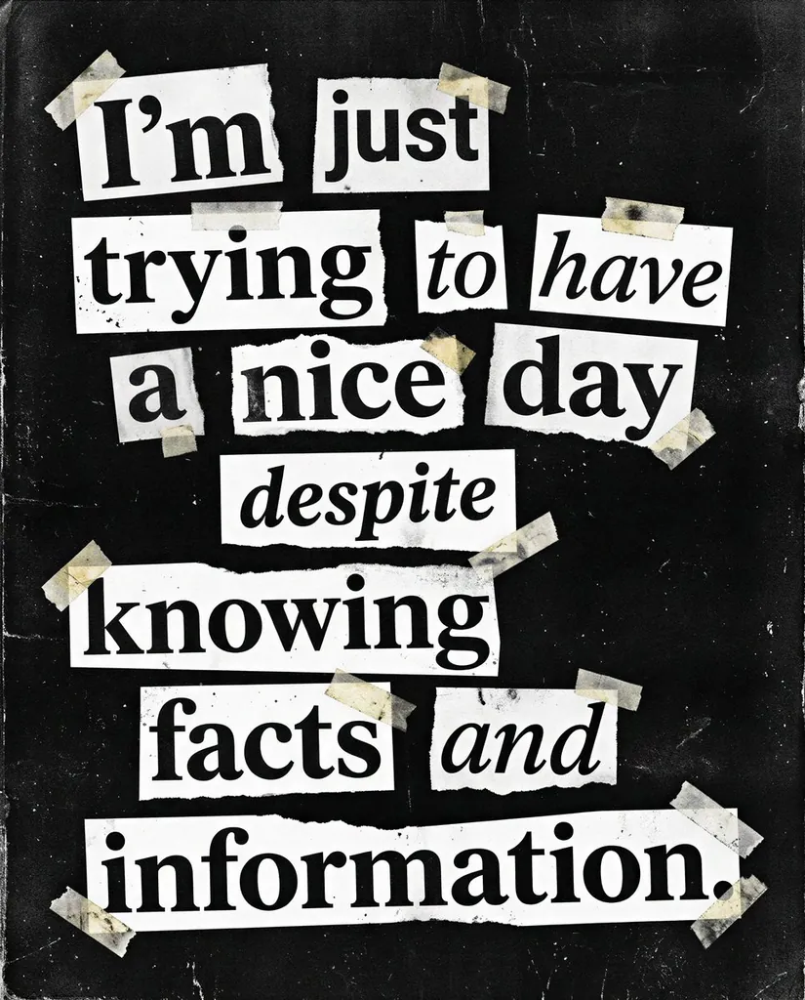

# Ransom-Note Collage Quote Poster — by @heathergreen

[← Back to Community Examples](../../EXAMPLES.md) · Category: Poster Design · Model: `Nano Banana 2.1`

<a href="https://x.com/heathergreen/status/2124321978911711493"></a>

Source: **[@heathergreen on X](https://x.com/heathergreen/status/2124321978911711493)** · Creator: [Heather Green](https://x.com/heathergreen)

## Prompt

```text
A high-contrast, black-and-white graphic design featuring a ransom-note aesthetic. The text "I'm just trying to have a nice day despite knowing facts and information" is composed of individual words cut from various newspapers and magazines, featuring diverse serif and sans-serif fonts. Each word is mounted on small, slightly misaligned white paper scraps, which are then attached to a dark, distressed, and textured black background. Small pieces of translucent adhesive tape are visible on the corners of several paper scraps, adding to the DIY, collage-style composition. The overall image has a gritty, grainy, and weathered appearance.
```

## Try it

Paste the prompt into **[vinano.ai](https://vinano.ai?utm_source=github&utm_medium=readme&utm_campaign=awesome-image-video-prompts-updating&utm_content=x-page-try)** to generate your own version.

> The image and prompt belong to @heathergreen ([original post](https://x.com/heathergreen/status/2124321978911711493)) and are shown here with credit for reference. Creators can ask for changes or removal by opening an issue.
