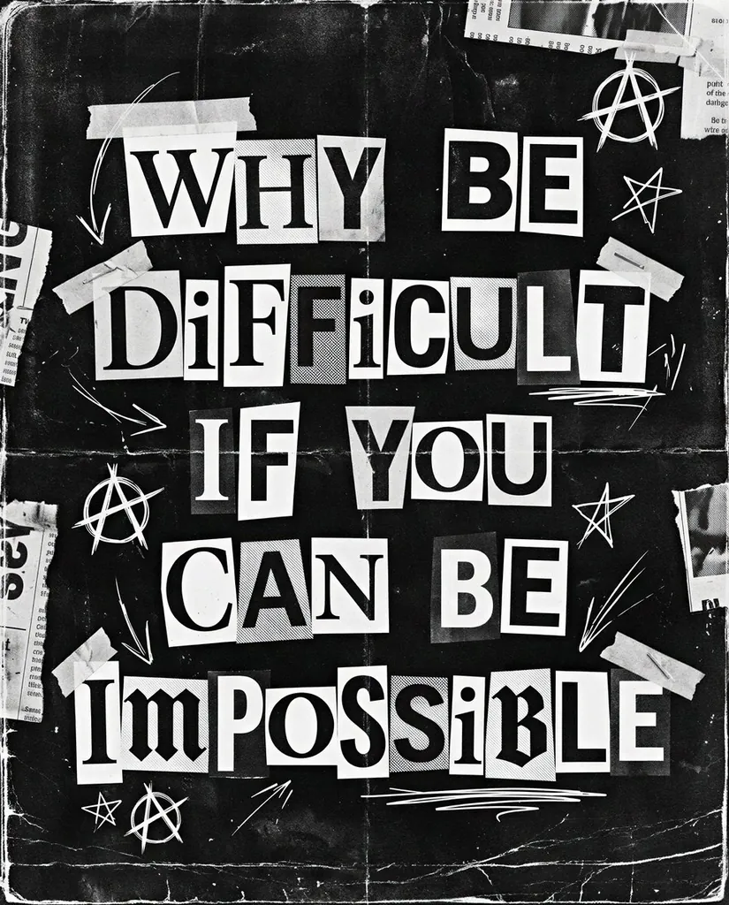

# Punk Ransom-Note Typography Poster — by @heathergreen

[← Back to Community Examples](../../EXAMPLES.md) · Category: Poster Design · Model: `Nano Banana 2.1`

<a href="https://x.com/heathergreen/status/2124684359680630949"></a>

Source: **[@heathergreen on X](https://x.com/heathergreen/status/2124684359680630949)** · Creator: [Heather Green](https://x.com/heathergreen)

## Prompt

```text
A high-contrast, black-and-white punk rock aesthetic poster featuring the text "WHY BE DIFFICULT IF YOU CAN BE IMPOSSIBLE" arranged in a ransom-note style. The letters are cut from various magazines and newspapers, featuring different serif and sans-serif fonts, pasted onto a dark, textured background. The composition is surrounded by scattered paper scraps, masking tape strips, hand-drawn anarchy symbols, and star doodles, creating a chaotic, DIY collage look with a gritty, distressed paper texture.
```

## Try it

Paste the prompt into **[vinano.ai](https://vinano.ai?utm_source=github&utm_medium=readme&utm_campaign=awesome-image-video-prompts-updating&utm_content=x-page-try)** to generate your own version.

> The image and prompt belong to @heathergreen ([original post](https://x.com/heathergreen/status/2124684359680630949)) and are shown here with credit for reference. Creators can ask for changes or removal by opening an issue.
