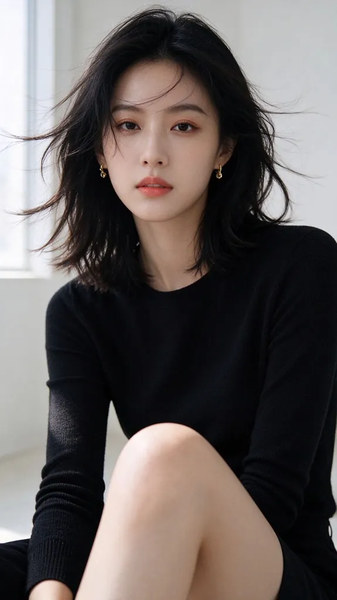

# Fashion Portrait with Knee in Foreground — by @lrsoy_

[← Back to Community Examples](../../EXAMPLES.md) · Category: Photography · Model: `Seedream 5.0 Pro`

<a href="https://x.com/lrsoy_/status/2124381772314239384"></a>

Source: **[@lrsoy_ on X](https://x.com/lrsoy_/status/2124381772314239384)** · Creator: [lrsoy_](https://x.com/lrsoy_)

## Prompt

```text
画幅比例为9：16 一位年轻成年亚洲女性，黑色锁骨发，发丝被微风吹起，几缕碎发自然凌乱，面部精致但保留真实感，清透底妆，淡橘棕色眼妆，柔和眉形，唇色自然偏珊瑚粉，皮肤细腻、带轻微毛孔与真实肤理。 她穿着黑色修身针织长袖上衣，佩戴小巧金色耳坠，坐在简洁室内空间中，一条腿自然抬起靠近镜头，制造前景透视和轻微压缩感。人物看向镜头，神情安静冷淡中带一点松弛感，像抓拍到的时尚人像。 浅灰白背景，极简布景，柔和棚拍主灯配合一点窗边自然光质感，头发边缘有细微轮廓光，画面干净但不过分商业修图。加入少量呼吸感细节：微微不完全对称的发丝、轻微下颌阴影、真实皮肤质感、眼神自然不过度锐利。 realistic editorial portrait, authentic beauty photography, minimal studio scene, black knit top, wind-swept hair, soft natural-studio mixed lighting, subtle skin pores, clean grey-white backdrop, seated close portrait, knee in foreground, slight low angle, elegant but realistic, high-end magazine portrait, not over-retouched, photorealistic, detailed hair strands, calm expression
```

## Try it

Paste the prompt into **[vinano.ai](https://vinano.ai?utm_source=github&utm_medium=readme&utm_campaign=awesome-image-video-prompts-updating&utm_content=x-page-try)** to generate your own version.

> The image and prompt belong to @lrsoy_ ([original post](https://x.com/lrsoy_/status/2124381772314239384)) and are shown here with credit for reference. Creators can ask for changes or removal by opening an issue.
