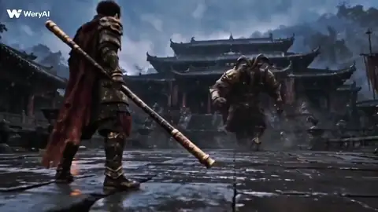

# Temple Courtyard Duel with a Horned Demon — by @draavenai

[← Back to Community Examples](../../EXAMPLES.md) · Category: Video · Model: `Seedance 2.0`

<a href="https://x.com/draavenai/status/2125058589333295234"></a>

**[▶ Watch the full video on X](https://x.com/draavenai/status/2125058589333295234)** — the preview above is a short silent clip.

Source: **[@draavenai on X](https://x.com/draavenai/status/2125058589333295234)** · Creator: [Draaven](https://x.com/draavenai)

## Prompt

```text
A breathtaking cinematic dark fantasy battle in an ancient Chinese temple courtyard during a stormy night. A fearless young warrior wearing dark bronze armor and a flowing red cape faces a gigantic terrifying demon warrior with massive curved horns and heavy golden armor. The young warrior holds a powerful wooden staff before transforming it into a blazing magical orange sword. The enormous horned demon charges forward, shaking the stone courtyard with every step. The warrior leaps into the air and launches a spectacular flaming sword attack. Sparks fly, magical energy fills the battlefield, and both warriors clash in an epic showdown. Dramatic slow motion, dynamic camera angles, realistic character movements, detailed armor, cinematic lighting, ultra-realistic 3D CGI, Hollywood fantasy movie style, 4K quality.
```

## Try it

Paste the prompt into **[vinano.ai](https://vinano.ai?utm_source=github&utm_medium=readme&utm_campaign=awesome-image-video-prompts-updating&utm_content=x-page-try)** to generate your own version.

> The video and prompt belong to @draavenai ([original post](https://x.com/draavenai/status/2125058589333295234)) and are shown here with credit for reference. Creators can ask for changes or removal by opening an issue.
