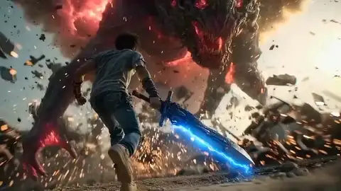

# Blue Lightning Sword Versus Tentacle Monster — by @draavenai

[← Back to Community Examples](../../EXAMPLES.md) · Category: Video · Model: `Seedance 2.0`

<a href="https://x.com/draavenai/status/2123786562139984156"></a>

**[▶ Watch the full video on X](https://x.com/draavenai/status/2123786562139984156)** — the preview above is a short silent clip.

Source: **[@draavenai on X](https://x.com/draavenai/status/2123786562139984156)** · Creator: [Draaven](https://x.com/draavenai)

## Prompt

```text
A breathtaking cinematic fantasy battle between a fearless young warrior and a gigantic terrifying red monster in a destroyed wasteland. The warrior wears a simple dark outfit and wields a massive sword glowing with intense electric blue energy. The enormous monster has multiple powerful tentacles, glowing red eyes, and dark armored skin. The warrior charges forward at incredible speed, swinging his energy sword and releasing powerful blue lightning waves. Massive rocks and debris fly through the air as the monster attacks with its giant tentacles. Epic aerial shots, dynamic camera movements, realistic motion, spectacular energy effects, dramatic lighting, ultra-detailed 3D CGI, Hollywood action movie style, 4K cinematic quality.
```

## Try it

Paste the prompt into **[vinano.ai](https://vinano.ai?utm_source=github&utm_medium=readme&utm_campaign=awesome-image-video-prompts-updating&utm_content=x-page-try)** to generate your own version.

> The video and prompt belong to @draavenai ([original post](https://x.com/draavenai/status/2123786562139984156)) and are shown here with credit for reference. Creators can ask for changes or removal by opening an issue.
