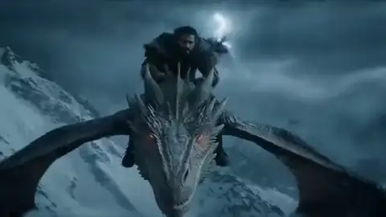

# Dragon Riders Battle Over Frozen Peaks — by @draavenai

[← Back to Community Examples](../../EXAMPLES.md) · Category: Video · Model: `Seedance 2.0`

<a href="https://x.com/draavenai/status/2123036871651704840"></a>

**[▶ Watch the full video on X](https://x.com/draavenai/status/2123036871651704840)** — the preview above is a short silent clip.

Source: **[@draavenai on X](https://x.com/draavenai/status/2123036871651704840)** · Creator: [Draaven](https://x.com/draavenai)

## Prompt

```text
Epic cinematic fantasy scene of two powerful dragon riders battling in the skies above a frozen mountain kingdom. Massive dark dragons with glowing orange eyes fly through storm clouds, their wings cutting through icy winds. Two armored warriors clash in midair, wielding glowing fiery swords. Lightning flashes across the sky as dragons unleash blazing fire, illuminating the snowy mountains and dark clouds. Dramatic camera movements, realistic dragon scales, detailed medieval armor, cinematic slow motion, volumetric fog, intense atmosphere, ultra-realistic CGI, IMAX quality, dark fantasy movie aesthetic, 4K, seamless action, breathtaking visual effects.
```

## Try it

Paste the prompt into **[vinano.ai](https://vinano.ai?utm_source=github&utm_medium=readme&utm_campaign=awesome-image-video-prompts-updating&utm_content=x-page-try)** to generate your own version.

> The video and prompt belong to @draavenai ([original post](https://x.com/draavenai/status/2123036871651704840)) and are shown here with credit for reference. Creators can ask for changes or removal by opening an issue.
