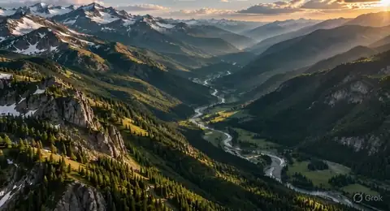

# Valley Flyover from a Still Frame — by @DavidLi36143625

[← Back to Community Examples](../../EXAMPLES.md) · Category: Video · Model: `Grok Imagine`

<a href="https://x.com/DavidLi36143625/status/2124706881923060021"></a>

**[▶ Watch the full video on X](https://x.com/DavidLi36143625/status/2124706881923060021)** — the preview above is a short silent clip.

Source: **[@DavidLi36143625 on X](https://x.com/DavidLi36143625/status/2124706881923060021)** · Creator: [David Liang](https://x.com/DavidLi36143625)

## Prompt

```text
Image Prompt (GPT Image 2.6 Sunburst):
A cinematic aerial flyover shot, 16:9 aspect ratio, over a vast mountain valley. The camera looks down at a steep angle, layered ridges receding into haze, a river winding through the valley floor far below. Pine forests darken the slopes, patches of snow on the highest peaks. Late afternoon sunlight rakes across the terrain, casting long shadows in the folds of the land. Photorealistic, natural light, high detail.

Video Prompt (Grok Imagine):
The camera glides forward smoothly over the valley, the ridges and river passing below. Haze drifts between the peaks. Shadows shift slowly as the light changes. Epic orchestral music swells, strings and brass building gradually.
```

## Try it

Paste the prompt into **[vinano.ai](https://vinano.ai?utm_source=github&utm_medium=readme&utm_campaign=awesome-image-video-prompts-updating&utm_content=x-page-try)** to generate your own version.

> The video and prompt belong to @DavidLi36143625 ([original post](https://x.com/DavidLi36143625/status/2124706881923060021)) and are shown here with credit for reference. Creators can ask for changes or removal by opening an issue.
