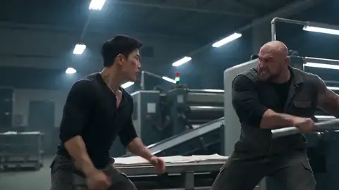

# Close-Quarters Fight in a Print Shop — by @Adam38363368936

[← Back to Community Examples](../../EXAMPLES.md) · Category: Video · Model: `Seedance 2.0`

<a href="https://x.com/Adam38363368936/status/2123742353709998574"></a>

**[▶ Watch the full video on X](https://x.com/Adam38363368936/status/2123742353709998574)** — the preview above is a short silent clip.

Source: **[@Adam38363368936 on X](https://x.com/Adam38363368936/status/2123742353709998574)** · Creator: [Adam也叫吉米](https://x.com/Adam38363368936)

## Prompt

```text
生成一段15秒、16:9横屏的写实电影级动作短片，直接根据文字生成。

【核心要求】
高密度、快节奏、连续近身格斗，像顶级动作电影里最燃的一段打戏。第一帧就在交手中，没有片头、走路、对峙或摆造型。全片不使用慢动作，所有动作都是实时速度。每个镜头约1.5秒，只完成一个清楚的攻防，并能看到击中后的结果。镜头之间动作紧密衔接，上一个动作的结果就是下一个动作的开始，全片没有停顿。

【人物】
男主：约30岁的成年东亚男性，短黑发，面容硬朗，身材精壮。穿黑色长袖衬衫、深灰工装裤、黑色工作靴，袖口卷起，没有武器。
对手：一名高大成年男性，光头，手臂有工业风纹身，穿深色工装背心、黑色长袖衫、厚重工作靴，右手握一根金属管。
全片只有这两个人，长相、服装和武器始终保持一致。

【场景】
深夜印刷厂，机器已经停机，冷白顶灯照亮大型印刷机、堆纸台、金属托盘和传送带。地面有纸张碎屑，空气中有细微粉尘，远处通风设备低鸣。全片都在同一台印刷机旁，机器、堆纸台、传送带和两人的位置前后连贯。

【分镜】
镜头1（0–1.5秒）：侧面中景。对手用金属管横扫男主下盘，男主抬脚躲过，金属管砸中金属托盘。
镜头2（1.5–3秒）：手持跟拍。对手用金属管顶端戳中男主腹部，男主后退撞向堆纸台。
镜头3（3–4.5秒）：中景。男主闪开对手砸击，用肘击打中对手肋部。
镜头4（4.5–6秒）：中景。对手抓住男主把他后背撞向印刷机机身。
镜头5（6–7.5秒）：侧面中景。对手再次挥管，男主抓住金属管中段。
镜头6（7.5–9秒）：近景。男主踹对手膝盖并扭转金属管，对手松手，金属管滚到堆纸台旁。
镜头7（9–10.5秒）：中景。对手挥拳，男主格开后连续短拳打中他胸口。
镜头8（10.5–12秒）：中景。对手扑来抱摔，男主顺势压住他的头颈。
镜头9（12–13.5秒）：稍宽中景。男主把对手甩向印刷机机身，对手撞后倒地。
镜头10（13.5–15秒）：男主面部近景，冷白顶灯照在脸上，脸上有灰和擦伤，喘着粗气，眼神狠厉盯着倒地对手，画面直接结束。

【动作与摄影】
写实电影质感，冷白工业灯光、金属印刷机、纸张碎屑、粉尘和机械空间层次，人物脸部清楚。每一拳、每一脚都要先接触目标，再出现身体受力、后退或失衡，不能打空气，也不能没碰到就提前倒下。动作贴身凶狠，借用印刷机、堆纸台、传送带和金属托盘发力，被打会疼、会失衡，不是无敌。撞击瞬间可以有轻微镜头震动，但必须看清谁打中了谁。人物左右位置在相邻镜头之间保持一致，不瞬移，不穿模，不增加多余的手或武器。金属管脱手后留在堆纸台旁，没有人再捡起它。不使用空翻、飞踢或超能力，不出现血腥特写。镜头集中在动作上，不刻意特写身体部位。

【声音】
印刷厂空旷回响，通风设备低鸣。金属管砸托盘、戳腹部、撞印刷机、金属管落地、击打、摔地、纸张碎屑飞起的声音都和画面准确同步。从第一秒开始就是紧张、快速、鼓点密集的动作配乐；男主被撞印刷机时音乐短暂压低，反转后节奏重新爆发，在最后撞机倒地时达到最强，结尾留下喘息和通风声。
无对白，无旁白，无字幕，无文字，无水印。
```

## Try it

Paste the prompt into **[vinano.ai](https://vinano.ai?utm_source=github&utm_medium=readme&utm_campaign=awesome-image-video-prompts-updating&utm_content=x-page-try)** to generate your own version.

> The video and prompt belong to @Adam38363368936 ([original post](https://x.com/Adam38363368936/status/2123742353709998574)) and are shown here with credit for reference. Creators can ask for changes or removal by opening an issue.
