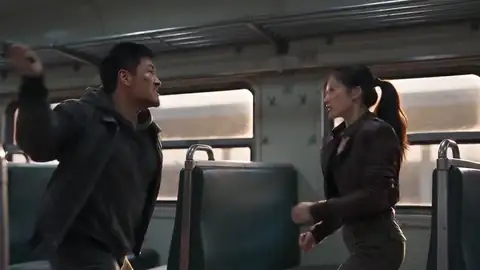

# Chain Fight Inside an Old Train Carriage — by @Adam38363368936

[← Back to Community Examples](../../EXAMPLES.md) · Category: Video · Model: `Seedance 2.0`

<a href="https://x.com/Adam38363368936/status/2123082060323754024"></a>

**[▶ Watch the full video on X](https://x.com/Adam38363368936/status/2123082060323754024)** — the preview above is a short silent clip.

Source: **[@Adam38363368936 on X](https://x.com/Adam38363368936/status/2123082060323754024)** · Creator: [Adam也叫吉米](https://x.com/Adam38363368936)

## Prompt

```text
生成一段15秒、16:9横屏的写实电影级动作短片，直接根据文字生成。

【核心要求】
高密度、快节奏、连续近身格斗，像顶级动作电影里最燃的一段打戏。第一帧就在交手中，没有片头、走路、对峙或摆造型。全片不使用慢动作，所有动作都是实时速度。每个镜头约1.5秒，只完成一个清楚的攻防，并能看到击中后的结果。镜头之间动作紧密衔接，上一个动作的结果就是下一个动作的开始，全片没有停顿。

【人物】
女主：约27岁的成年东亚女性，黑色长发扎成马尾，眼神锋利，身材匀称有力量。穿深棕短皮夹克、黑色针织衫、深色工装裤、黑色高帮靴，没有武器。
对手：一名高大成年男性，短发，穿旧黑色皮夹克、深灰连帽衫、深色长裤，右手握一根铁链。
全片只有这两个人，长相、服装和武器始终保持一致。女主全程没有被摔倒在地。

【场景】
停在站台的老式火车车厢内部，窗外是傍晚昏黄光线，车厢座椅为深绿色皮革，金属扶手有磨损，地面有灰尘和零散纸箱。全片都在同一排座椅附近，座椅、扶手、纸箱和两人的位置前后连贯。

【分镜】
镜头1（0–1.5秒）：侧面中景。对手挥动铁链横扫，女主低头躲过，铁链抽中座椅靠背。
镜头2（1.5–3秒）：手持跟拍。对手用铁链末端甩中女主肩侧，女主弯腰后退，重心稳住，没有倒地。
镜头3（3–4.5秒）：中景。女主闪开对手撞击，用后肘打中对手肋部，对手明显吃痛缩身。
镜头4（4.5–6秒）：中景。对手抓住女主把她顶向金属扶手，女主侧腰受力，踉跄一下，但双脚始终踩地，没有倒地。
镜头5（6–7.5秒）：侧面中景。对手再次挥链，女主抓住铁链中段，两人互相角力拉扯。
镜头6（7.5–9秒）：近景。女主突然松链并踹对手膝盖，对手重心失衡，铁链落到座椅旁，不再被捡起。
镜头7（9–10.5秒）：中景。对手挥拳，女主格开后连续短拳打中对手腹部，对手接连后退。
镜头8（10.5–12秒）：中景。对手向前猛扑试图抱摔女主，女主立刻侧胯卸力，前臂压住对手肩颈，顺势控制对手重心，女主双脚始终不离地。
镜头9（12–13.5秒）：稍宽中景。女主借对手前冲惯性，将对手甩向座椅扶手，对手撞击扶手后重重倒地，不再站起。
镜头10（13.5–15秒）：女主面部近景，昏黄窗光斜照脸上，脸上有灰和擦伤，胸口起伏，眼神冰冷盯着倒地对手，画面直接结束。

【动作与摄影】
写实电影质感，老式车厢的昏黄窗光、深绿皮革座椅、磨损金属扶手，暗部保留细节，人物脸部清楚。每一拳、每一脚都要先接触目标，再出现身体受力、后退或失衡，不能打空气，也不能没碰到就提前倒下。女主动作利落凶狠，借力打力，被击打会疼、会踉跄，但全程没有摔倒。撞击瞬间可以有轻微镜头震动，但必须看清谁打中了谁。人物左右位置在相邻镜头之间保持一致，不瞬移，不穿模，不增加多余的手或武器。铁链脱手后留在座椅旁，没有人再捡起它。不使用空翻、飞踢或超能力，不出现血腥特写。镜头集中在动作上，不刻意特写身体部位。

【声音】
老式车厢空旷回响，远处站台环境声低弱。铁链抽座椅、撞扶手、铁链落地、击打、摔地、纸箱翻倒的声音都和画面准确同步。从第一秒开始就是紧张、快速、鼓点密集的动作配乐；女主被撞扶手时音乐短暂压低，反转后节奏重新爆发，在最后撞扶手倒地时达到最强，结尾留下喘息和金属轻响。
无对白，无旁白，无字幕，无文字，无水印。
```

## Try it

Paste the prompt into **[vinano.ai](https://vinano.ai?utm_source=github&utm_medium=readme&utm_campaign=awesome-image-video-prompts-updating&utm_content=x-page-try)** to generate your own version.

> The video and prompt belong to @Adam38363368936 ([original post](https://x.com/Adam38363368936/status/2123082060323754024)) and are shown here with credit for reference. Creators can ask for changes or removal by opening an issue.
