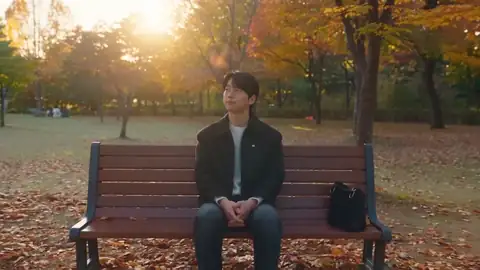

# Autumn Park Bench Romance — by @navi_Ai2

[← Back to Community Examples](../../EXAMPLES.md) · Category: Video · Model: `Seedance 2.5`

<a href="https://x.com/navi_Ai2/status/2123049897717035263"></a>

**[▶ Watch the full video on X](https://x.com/navi_Ai2/status/2123049897717035263)** — the preview above is a short silent clip.

Source: **[@navi_Ai2 on X](https://x.com/navi_Ai2/status/2123049897717035263)** · Creator: [𝐍𝐚𝐯𝐞𝐞 𝐀𝐢](https://x.com/navi_Ai2)

## Prompt

```text
Create a 30-second cinematic Korean romance scene set in a beautiful autumn park during golden hour. A young Korean man wearing a black jacket sits alone on a wooden bench surrounded by golden autumn leaves, quietly waiting. Warm sunlight filters through the trees as a gentle breeze moves the fallen leaves. A young Korean woman wearing a beige coat approaches and sits beside him. They exchange shy smiles, share a quiet moment, and take a selfie together, smiling naturally. As the moment fades, the man notices her expression change and gently turns toward her, as if sensing something she cannot say. She looks down with a bittersweet smile while he watches her with concern.

Use realistic Korean actors, subtle facial expressions, natural body movements, cinematic close-ups, slow camera movements, shallow depth of field, warm golden lighting, soft autumn colors, realistic skin texture, film-quality cinematography, emotional Korean drama atmosphere, and a gentle cinematic soundtrack.

The ending should feel beautiful, intimate, and slightly bittersweet, leaving the audience wondering what their story is. Ultra-realistic live-action, no artificial animation, no exaggerated expressions, no text, no watermark.
```

## Try it

Paste the prompt into **[vinano.ai](https://vinano.ai?utm_source=github&utm_medium=readme&utm_campaign=awesome-image-video-prompts-updating&utm_content=x-page-try)** to generate your own version.

> The video and prompt belong to @navi_Ai2 ([original post](https://x.com/navi_Ai2/status/2123049897717035263)) and are shown here with credit for reference. Creators can ask for changes or removal by opening an issue.
