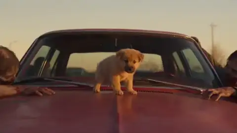

# Puppy Rescue from a Zombie Horde — by @AIwithWania

[← Back to Community Examples](../../EXAMPLES.md) · Category: Video · Model: `Seedance 2.5`

<a href="https://x.com/AIwithWania/status/2123028132223688868"></a>

**[▶ Watch the full video on X](https://x.com/AIwithWania/status/2123028132223688868)** — the preview above is a short silent clip.

Source: **[@AIwithWania on X](https://x.com/AIwithWania/status/2123028132223688868)** · Creator: [Wania](https://x.com/AIwithWania)

## Prompt

```text
Create a 30-second ultra-realistic cinematic Korean superhero action video.

A small adorable puppy is sitting on the roof of a red car in an empty parking lot at sunset. Several terrifying zombies with scary faces, dirty clothes, and zombie-like movements surround the car and try to attack and grab the helpless puppy.

Suddenly, a powerful young Korean woman wearing a blue jacket and jeans rushes in to save the puppy. She possesses incredible superpowers, superhuman strength, and extraordinary jumping abilities. She fights the zombies with powerful punches, kicks, and spectacular flying jumps, defeating them one by one.

The zombies desperately try to reach the puppy, but the Korean girl protects it and fights them fearlessly. Finally, she defeats the zombies, picks up the frightened little puppy, and gently holds it in her arms.

Visual style: Hollywood zombie action movie, photorealistic Korean actress, realistic zombie makeup, spectacular superhero stunts, cinematic golden-hour lighting, dynamic camera movements, dramatic slow motion, realistic physics, and high-quality 4K visuals.

Maintain consistent character appearance throughout. Duration: exactly 30 seconds. Aspect ratio: 16:9. No text, subtitles, or watermark.
```

## Try it

Paste the prompt into **[vinano.ai](https://vinano.ai?utm_source=github&utm_medium=readme&utm_campaign=awesome-image-video-prompts-updating&utm_content=x-page-try)** to generate your own version.

> The video and prompt belong to @AIwithWania ([original post](https://x.com/AIwithWania/status/2123028132223688868)) and are shown here with credit for reference. Creators can ask for changes or removal by opening an issue.
