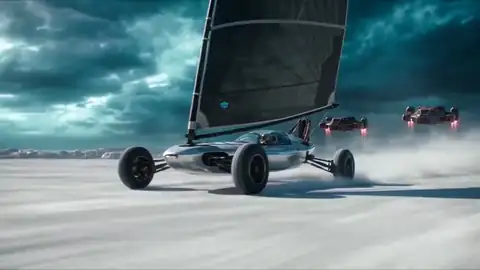

# Salt Flat Sail Racer Chase — by @DeCat2025

[← Back to Community Examples](../../EXAMPLES.md) · Category: Video · Model: `Unknown`

<a href="https://x.com/DeCat2025/status/2124347784614609262"></a>

**[▶ Watch the full video on X](https://x.com/DeCat2025/status/2124347784614609262)** — the preview above is a short silent clip.

Source: **[@DeCat2025 on X](https://x.com/DeCat2025/status/2124347784614609262)** · Creator: [DeCat](https://x.com/DeCat2025)

## Prompt

```text
The Salt Flat Phantom

Ultra-photorealistic Hollywood live-action science-fiction chase. Extreme speed, immense alien landscapes, physically believable wind forces, dramatic cinematic destruction and high-end practical-style visual effects.

LOCATION:
Endless brilliant-white alien salt flats under a dark turquoise storm sky. Strong crosswinds drive horizontal streams of salt dust across the ground. Ahead, a towering natural formation of brittle white salt crystal rises beside the racing route.

HERO VEHICLE:
Exactly one futuristic wind-powered land racer. Low silver aerodynamic chassis, three large black wheels, exposed mechanical steering linkage and ONE tall articulated sail made of two connected dark graphite panels. A single adult pilot sits inside a transparent enclosed cockpit.

The wind-driven racer has NO jet engines or exhaust flames. Its sail is its primary propulsion system.

PURSUERS:
Exactly TWO compact matte-black military hover skimmers with red sensor lights and forward precision weapons. They fly just above the salt surface, using visible downward thrusters.

The silver racer leads. Both black skimmers pursue from behind in the same direction.

SHOT 1 | 0–2s | GROUND-LEVEL SIDE TRACKING ANGLE
The silver sail racer rockets across the blinding salt flats at astonishing speed. Its wheels carve thin tracks through the white crust. The enormous sail flexes under the crosswind. Two black military skimmers skim the surface behind it, firing brilliant red precision bolts that explode against the salt.

SHOT 2 | 2–4s | HIGH THREE-QUARTER ANGLE
The racer cuts across a field of jagged salt ridges. The pilot steers through a narrow opening while both skimmers follow. Weapon impacts shatter enormous white crystal fragments beside the racer. Wind drives long plumes of salt dust diagonally across the battlefield.

SHOT 3 | 4–6s | LOW FRONT THREE-QUARTER ANGLE
A skimmer closes to the racer's right side and fires into the upper sail. A projectile punches through one graphite panel, leaving a visible damaged opening. The sail remains attached. The pilot struggles against the increased wind pressure as the vehicle shudders but continues forward.

SHOT 4 | 6–8s | COCKPIT-SIDE MECHANICAL ANGLE
The pilot activates a large mechanical sail control. Hydraulic actuators rapidly rotate the entire articulated sail across the crosswind. The sail spills wind pressure and the racer's speed drops sharply. The chassis leans, and all three wheels remain firmly on the salt.

SHOT 5 | 8–10s | LOW REAR THREE-QUARTER ANGLE
The leading military skimmer is still accelerating behind the slowing racer. Its pilotless guidance system reacts too late. The skimmer overshoots along the racer's right side. The second skimmer brakes and banks away. The first skimmer continues directly toward the towering salt crystal formation ahead.

SHOT 6 | 10–12.5s | FIXED SALT-CRYSTAL SIDE ANGLE
The overshooting skimmer strikes the base of the towering salt formation at high speed. Its armored nose crumples, followed by a violent explosion. The giant crystal tower fractures and collapses across the route behind the escaping racer. The second skimmer pulls away from the falling debris and disappears behind the collapsing crystal wall.

SHOT 7 | 12.5–15s | FIXED LOW WIDE THREE-QUARTER ANGLE
The silver wind racer continues safely beyond the collapsed crystal formation, its sail restored to a forward-driving angle. Behind it, an immense white wall of broken salt crystal blocks the pursuit route. One destroyed skimmer lies beneath the debris. The other remains hidden beyond the obstruction.

By 13 seconds, the collapse is complete. The racer continues steadily into the open salt desert. Hold this final victorious composition with no camera movement through the end.

CAMERA AND PHYSICS:
Exactly seven distinct cinematic angles. Maintain consistent screen direction and clear geography. The racer never flies or jumps. Wind pressure drives its wheels along the surface. Rotating the sail spills wind and creates a sudden but believable reduction in speed. The faster hover skimmer overshoots due to its momentum. The crystal formation collapses only after the skimmer strikes its base.

AUDIO:
Howling crosswinds, high-frequency wind cutting across the sail, rapid rolling wheels, mechanical sail actuators, deep hover thrusters, sharp energy-weapon impacts, shattering salt crystal, heavy vehicle collision and immense crystalline collapse. No dialogue or narration.

CONTINUITY:
One silver three-wheeled sail racer with one attached articulated sail throughout. Exactly two black pursuit skimmers. The right-side skimmer overshoots and crashes. The second skimmer avoids impact but is cut off by the collapse. Maintain the sail damage after the projectile strike, consistent vehicles, wind direction, lighting, positions and physical scale.

RESTRICTIONS:
No ordinary cars, trucks, highways, aircraft wings, flying hero vehicle, duplicated sails, extra wheels, multiple pilots, extra skimmers, vehicle redesigns, teleportation, arbitrary explosions, impossible vehicle motion, repetitive shots, empty driving, camera drift, zoom-out, famous faces or public-figure likenesses.

No new action during the completed ending.

Keep proportions. Keep style and features. Ratio 16:9.
```

## Try it

Paste the prompt into **[vinano.ai](https://vinano.ai?utm_source=github&utm_medium=readme&utm_campaign=awesome-image-video-prompts-updating&utm_content=x-page-try)** to generate your own version.

> The video and prompt belong to @DeCat2025 ([original post](https://x.com/DeCat2025/status/2124347784614609262)) and are shown here with credit for reference. Creators can ask for changes or removal by opening an issue.
