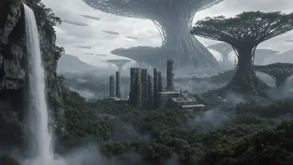

# Drone Through an Overgrown Jungle Moon Base — by @Alin_Reaper05

[← Back to Community Examples](../../EXAMPLES.md) · Category: Video · Model: `Kling 4.0`

<a href="https://x.com/Alin_Reaper05/status/2124425737499496926"></a>

**[▶ Watch the full video on X](https://x.com/Alin_Reaper05/status/2124425737499496926)** — the preview above is a short silent clip.

Source: **[@Alin_Reaper05 on X](https://x.com/Alin_Reaper05/status/2124425737499496926)** · Creator: [Alin](https://x.com/Alin_Reaper05)

## Prompt

```text
A mysterious jungle moon covered with immense alien trees, dense mist and gigantic waterfalls. Deep within the vegetation stands an enormous abandoned futuristic research complex, its towering metallic structures slowly reclaimed by the surrounding forest. A solitary automated reconnaissance drone flies between the overgrown buildings while distant orbital ships cross the cloudy sky. The camera follows the drone toward a monumental sealed laboratory entrance. Atmospheric cinematic exploration, photorealistic
```

## Try it

Paste the prompt into **[vinano.ai](https://vinano.ai?utm_source=github&utm_medium=readme&utm_campaign=awesome-image-video-prompts-updating&utm_content=x-page-try)** to generate your own version.

> The video and prompt belong to @Alin_Reaper05 ([original post](https://x.com/Alin_Reaper05/status/2124425737499496926)) and are shown here with credit for reference. Creators can ask for changes or removal by opening an issue.
