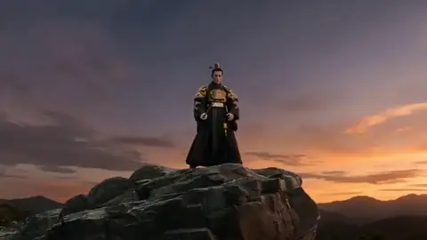

# Sword Strike on a Sunset Cliff — by @draavenai

[← Back to Community Examples](../../EXAMPLES.md) · Category: Video · Model: `Seedance 2.0`

<a href="https://x.com/draavenai/status/2123635495976788233"></a>

**[▶ Watch the full video on X](https://x.com/draavenai/status/2123635495976788233)** — the preview above is a short silent clip.

Source: **[@draavenai on X](https://x.com/draavenai/status/2123635495976788233)** · Creator: [Draaven](https://x.com/draavenai)

## Prompt

```text
A cinematic ancient Chinese fantasy warrior standing on a massive rocky cliff during a dramatic sunset. He wears an elegant black and golden embroidered battle robe with intricate dragon patterns and holds a long legendary sword. Dark mountains stretch across the horizon beneath a glowing orange and purple sky. The warrior slowly raises his sword as mysterious black smoke and magical dark energy swirl around his body. He performs a powerful sword strike, releasing a wave of supernatural energy that causes the surrounding rocks to crack and explode into flying debris. Dramatic close-up shots, dynamic camera movements, realistic fabric physics, detailed sword design, epic martial arts atmosphere, cinematic lighting, ultra-realistic 3D CGI, 4K fantasy movie quality.
```

## Try it

Paste the prompt into **[vinano.ai](https://vinano.ai?utm_source=github&utm_medium=readme&utm_campaign=awesome-image-video-prompts-updating&utm_content=x-page-try)** to generate your own version.

> The video and prompt belong to @draavenai ([original post](https://x.com/draavenai/status/2123635495976788233)) and are shown here with credit for reference. Creators can ask for changes or removal by opening an issue.
