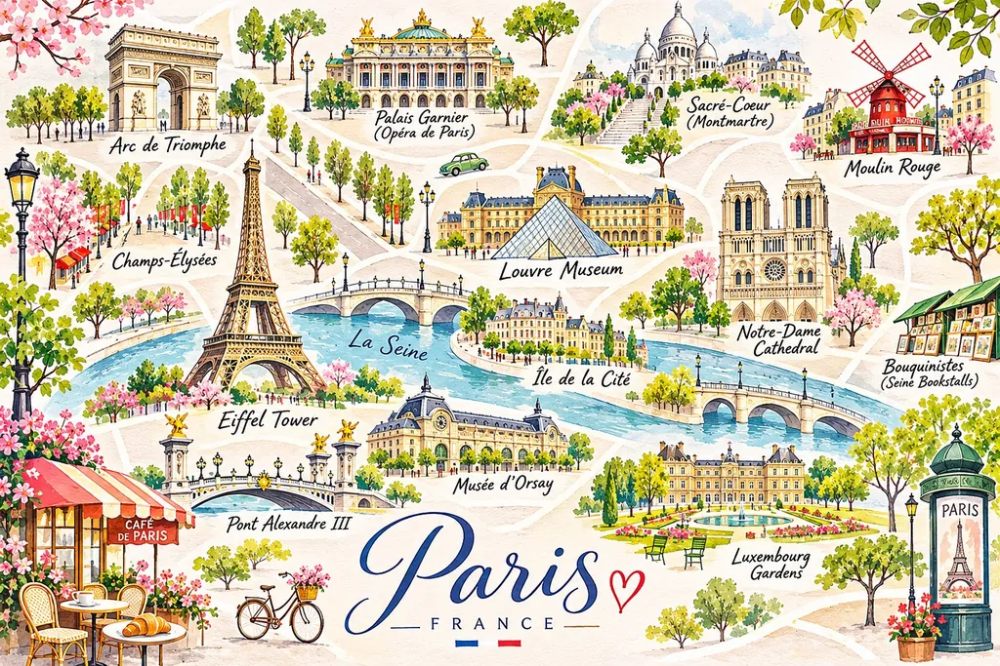

# Whimsical Hand-Illustrated City Tourist Map — by @Naiknelofar788

[← Back to Community Examples](../../EXAMPLES.md) · Category: Illustration & 3D · Model: `GPT Image 2.6`

<a href="https://x.com/Naiknelofar788/status/2125072697982091620"></a>

Source: **[@Naiknelofar788 on X](https://x.com/Naiknelofar788/status/2125072697982091620)** · Creator: [simeon-sanai](https://x.com/Naiknelofar788)

## Prompt

```text
Create an exceptionally charming, whimsical, hand-illustrated tourist map of [CITY], [COUNTRY], featuring its most famous landmarks, historic attractions, neighbourhoods and cultural treasures.

1. OVERALL MAP DESIGN

Create a beautifully illustrated bird’s-eye-view city map on a soft, pale pastel background.

The composition should resemble a hand-painted travel guide or an illustrated page from a vintage children’s atlas.

Include winding white streets, curved roads, a flowing river where geographically appropriate, little bridges, parks, gardens, trees and charming urban details.

The map should feel organic, playful and full of discoveries.

2. ICONIC LANDMARKS — MOST IMPORTANT

Feature 12–16 recognisable attractions distributed throughout the map.

Include a carefully selected combination of:

Famous historical monuments.
Iconic architectural buildings.
Museums and cultural attractions.
Historic squares and streets.
Religious and heritage sites.
Beautiful gardens and parks.
Famous bridges and towers.
Distinctive neighbourhoods.

Illustrate every attraction as a small, individually detailed architectural vignette, viewed from an attractive elevated perspective.

Preserve the recognisable architectural identity of each landmark.

3. LABEL EVERY PLACE

This is an essential feature.

Write the actual, correct name of every illustrated landmark directly beside or underneath its illustration.

Use neat, small, hand-lettered typography in dark charcoal or black.

Make every label readable, correctly spelled and associated with the correct attraction.

Do not use generic labels or invent landmark names.

4. LITTLE CITY DETAILS

Add charming miniature details throughout the map:

Tiny cars, bicycles and buses.
Walking people.
Street trees and benches.
Local food and cafés.
Small boats where appropriate.
Local cultural symbols.
Traditional architecture.
Little market scenes.

Include details that make the destination feel alive and authentic.

5. DESTINATION-INSPIRED COLOURS

Use a beautiful muted colour palette inspired by the city’s character.

Soft sage green, dusty blue, warm beige, pale terracotta, muted mustard and gentle pastel shades.

Adapt the colours to each destination rather than repeating exactly the same palette.

6. CITY TITLE

At the bottom centre, display the destination name in beautiful, elegant lettering:

[ CITY NAME ]

Below it, in smaller lettering:

[ COUNTRY NAME ]

7. ARTISTIC FINISH

Delicate hand-drawn outlines, soft watercolor washes, subtle paper texture, charming imperfect illustration, simplified architectural details and beautiful visual storytelling.

The overall result should feel like a collectible illustrated tourist map created by a talented travel illustrator.

Landscape 4:3 composition, clean artistic layout, sophisticated yet playful, plenty of breathing space.

Avoid photorealism, 3D effects, excessive decoration, crowded labels and inaccurate architecture.
```

## Try it

Paste the prompt into **[vinano.ai](https://vinano.ai?utm_source=github&utm_medium=readme&utm_campaign=awesome-image-video-prompts-updating&utm_content=x-page-try)** to generate your own version.

> The image and prompt belong to @Naiknelofar788 ([original post](https://x.com/Naiknelofar788/status/2125072697982091620)) and are shown here with credit for reference. Creators can ask for changes or removal by opening an issue.
