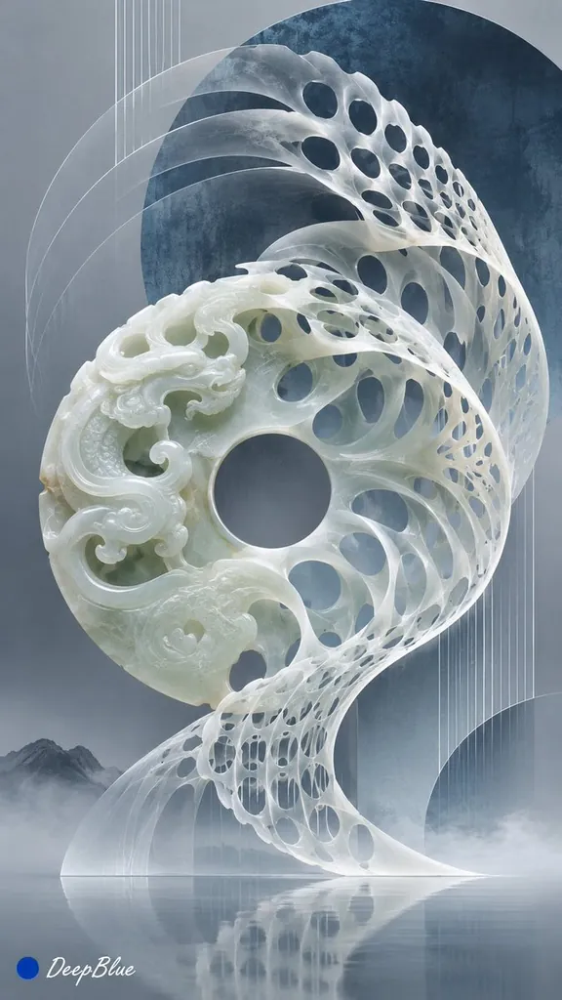

# Eastern Artifacts as Generative Forms — by @DeepBlueX0

[← Back to Community Examples](../../EXAMPLES.md) · Category: Illustration & 3D · Model: `GPT Image 2.6`

<a href="https://x.com/DeepBlueX0/status/2125228695396766184"></a>

Source: **[@DeepBlueX0 on X](https://x.com/DeepBlueX0/status/2125228695396766184)** · Creator: [DeepBlue深藍](https://x.com/DeepBlueX0)

## Prompt

```text
東方傳統器物 × Generative Form Design × 東方極簡。

每張獨立隨機選擇一件東方傳統器物，器物種類、材質、年代、用途與文化來源自由變化。可從陶瓷、青銅、漆器、玉器、竹木器、金銀器、文房器、祭器、日用器、樂器或佩飾中自由抽取，避免集中在同一類器物。

保留抽中器物的核心辨識特徵，從其輪廓、結構、紋樣或使用方式中提取獨特的形態生成規律，發展出具有內在秩序的全新視覺形態。

每張獨立探索不同的生成方式，可表現為分裂、生長、堆疊、旋轉、展開、穿透、折疊、鏤空、流動、重組或拓撲式轉換，不要重複相同的變形機制。

自由選擇色彩、材質、構圖、視角與藝術表現媒介，通過尺度反差、疏密節奏、虛實對比與結構張力，呈現強烈的視覺衝擊力、精密技術美感與東方極簡意境。

三張作品在器物類型、生成機制、畫面構成與整體氣質上都應明顯不同。

9:16直式獨立單圖，每張分別生成，不自動裁切。

左下深藍色實心圓點，後接白色自然手寫體「DeepBlue」。

n=9
```

## Try it

Paste the prompt into **[vinano.ai](https://vinano.ai?utm_source=github&utm_medium=readme&utm_campaign=awesome-image-video-prompts-updating&utm_content=x-page-try)** to generate your own version.

> The image and prompt belong to @DeepBlueX0 ([original post](https://x.com/DeepBlueX0/status/2125228695396766184)) and are shown here with credit for reference. Creators can ask for changes or removal by opening an issue.
