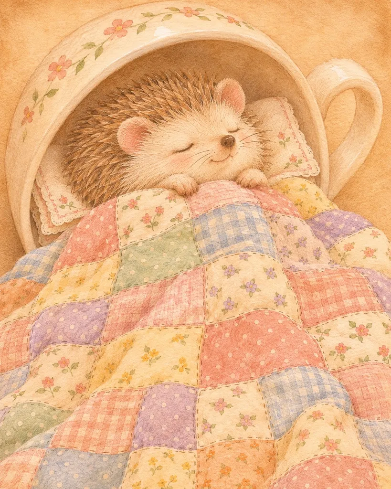

# Hedgehog Asleep Under a Patchwork Quilt — by @static_stare

[← Back to Community Examples](../../EXAMPLES.md) · Category: Illustration & 3D · Model: `GPT Image 2.5`

<a href="https://x.com/static_stare/status/2125087899591041227"></a>

Source: **[@static_stare on X](https://x.com/static_stare/status/2125087899591041227)** · Creator: [mo Ki](https://x.com/static_stare)

## Prompt

```text
Create an image with the following visual system. Replace the subject as specified.

Visual system (light, color, composition, medium, mood):
【画面风格】一张竖幅约 4:5 的老派儿童绘本插画，透明水彩打底，再用彩色铅笔细细地叠出毛发、木纹和布纹，像一页印在温暖米黄色水彩纸上的原画，纸面的粗颗粒和水彩晕开的边清楚可见，不是数字平涂，不是 3D，也不是照片。机位是近景、略微俯视，正对着一张小小的床（床的样子由主体决定），睡着的小动物占画面上半部分，下半部分几乎被一床大大的拼布被铺满：被子由许多小方块布拼成，每一块是不同的柔和颜色：珊瑚粉、奶油黄、雾蓝、薄荷绿、淡紫、杏橘，每块上面都有用彩铅点出来的小碎花、小格子或小点点花纹，方块之间有细细的缝线，被子边缘自然垂下、有柔软的褶皱。小动物闭着眼、表情安详满足，毛发用一根根细彩铅线画出，耳朵内侧透着淡粉色，胡须是极细的深色线。光是柔和均匀的暖光，像午后的室内，没有强烈投影，只在被子褶皱、枕头凹陷和小动物下巴底下有一点淡淡的暖棕色阴影。整体以暖赭石、蜂蜜黄、米白为底色，拼布的粉、蓝、绿、紫是点缀，饱和度都偏低、像晒旧了的颜色。背景就是空的米黄纸面，四周带一点更深的暖棕晕染。气氛安静、暖和，看一眼就想打哈欠。画面里不要任何文字、签名、印章和水印。

New subject:
【主体】一只圆滚滚的小刺猬蜷在一只放倒的大号奶白色陶瓷茶杯里当床，杯沿就是床头，头枕着一块叠起来的小手帕，背上的刺是一根根浅棕色彩铅线，鼻尖露在外面；一小床拼布被从杯口铺出来，盖住它的身子，垂到画面底部。
```

## Try it

Paste the prompt into **[vinano.ai](https://vinano.ai?utm_source=github&utm_medium=readme&utm_campaign=awesome-image-video-prompts-updating&utm_content=x-page-try)** to generate your own version.

> The image and prompt belong to @static_stare ([original post](https://x.com/static_stare/status/2125087899591041227)) and are shown here with credit for reference. Creators can ask for changes or removal by opening an issue.
