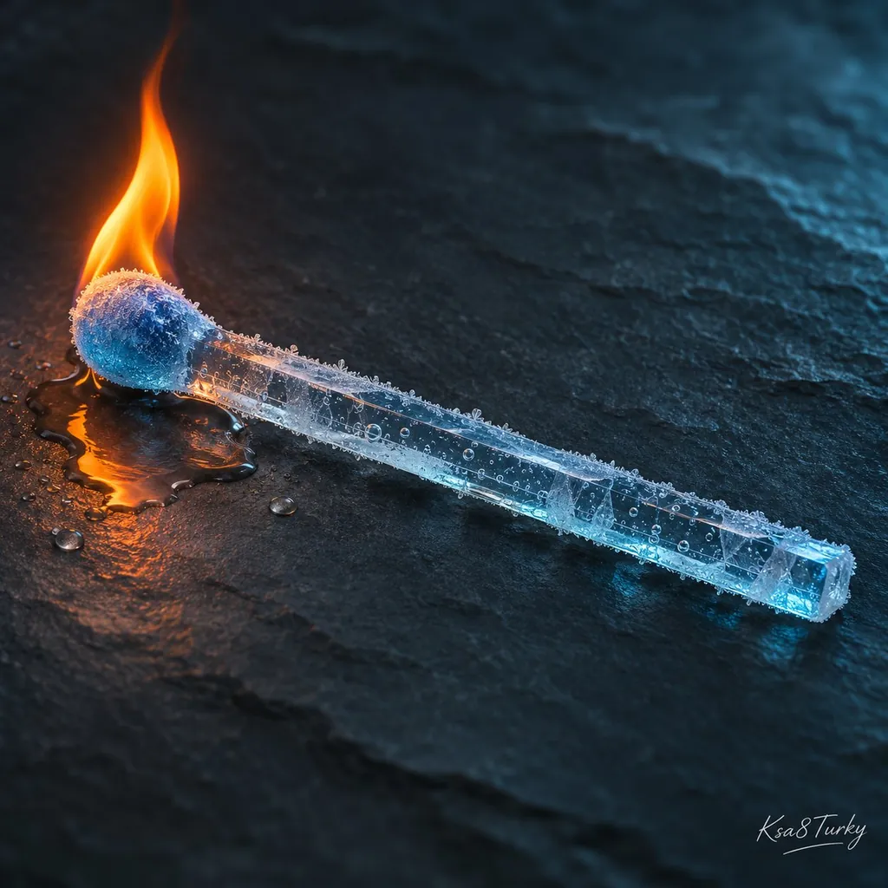

# Everyday Object in an Impossible Material — by @ksa8Turky

[← Back to Community Examples](../../EXAMPLES.md) · Category: Product & Brand · Model: `GPT Image`

<a href="https://x.com/ksa8Turky/status/2125349490970476560"></a>

Source: **[@ksa8Turky on X](https://x.com/ksa8Turky/status/2125349490970476560)** · Creator: [‏Turky](https://x.com/ksa8Turky)

## Prompt

```text
Create a square surreal macro studio photograph of ONE recognizable [EVERYDAY OBJECT] made entirely from [UNEXPECTED MATERIAL], paired with [CONTRADICTORY PHENOMENON]. Example: a transparent blue-ice matchstick with an orange flame above its frosted head. Preserve coherent geometry and detailed material cues. Matte charcoal surface, cold rim light, warm reflections and realistic contact shadows. No people, brands or headline. Small legible Ksa8Turky bottom right. Intentional impossible AI artwork.
```

## Try it

Paste the prompt into **[vinano.ai](https://vinano.ai?utm_source=github&utm_medium=readme&utm_campaign=awesome-image-video-prompts-updating&utm_content=x-page-try)** to generate your own version.

> The image and prompt belong to @ksa8Turky ([original post](https://x.com/ksa8Turky/status/2125349490970476560)) and are shown here with credit for reference. Creators can ask for changes or removal by opening an issue.
