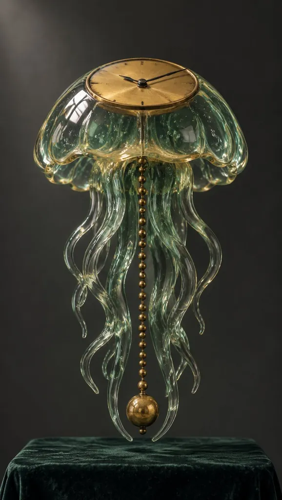

# Glass Jellyfish Clock Sculpture — by @Andy4aicreate

[← Back to Community Examples](../../EXAMPLES.md) · Category: Illustration & 3D · Model: `GPT Image 2.6 Flare`

<a href="https://x.com/Andy4aicreate/status/2125383268895752541"></a>

Source: **[@Andy4aicreate on X](https://x.com/Andy4aicreate/status/2125383268895752541)** · Creator: [Andy](https://x.com/Andy4aicreate)

## Prompt

```text
一张严格九比十六竖版的超现实生物雕塑摄影。画面唯一主体是一件虚构的生命形态雕塑：外形如一只透明钵水母，伞状顶部却是一面微缩黄铜座钟表盘，表盘上没有数字刻度，只有两根纤细的黑色指针。水母的触手垂落向下，末端自然收束成一串黄铜钟摆链，链珠随悬垂角度自然下坠，不悬浮、不违反重力。

雕塑整体以吹制玻璃为主体材质，玻璃通透带着淡淡的深海绿，内部隐约可见极细的气泡纹。钟面与钟摆链部分为抛光黄铜镶嵌，边缘有细腻的做旧痕迹，玻璃与黄铜的接缝处理得自然可信，没有生硬的拼接感。

雕塑安放在一张深色丝绒展台上，展台边缘有细微压痕，背景是纯净的暗灰影棚色，没有任何道具或文字。主光源从左上方四十五度打来，在玻璃表面形成清晰的高光与内部折射光斑，黄铜部分吸收暖光，呈现温润的金色反射；展台表面留下柔和的接触阴影。

整体配色以黄铜金与深海绿为主，辅以暗灰背景与极少量冷白高光，色彩干净、层次分明。雕塑表面材质真实可信，呈现摄影棚产品摄影般的精密质感，不做卡通化处理，不添加多余装饰。

严格九比十六竖版单图。画面中不加任何文字、签名、水印或品牌标志。
```

## Try it

Paste the prompt into **[vinano.ai](https://vinano.ai?utm_source=github&utm_medium=readme&utm_campaign=awesome-image-video-prompts-updating&utm_content=x-page-try)** to generate your own version.

> The image and prompt belong to @Andy4aicreate ([original post](https://x.com/Andy4aicreate/status/2125383268895752541)) and are shown here with credit for reference. Creators can ask for changes or removal by opening an issue.
