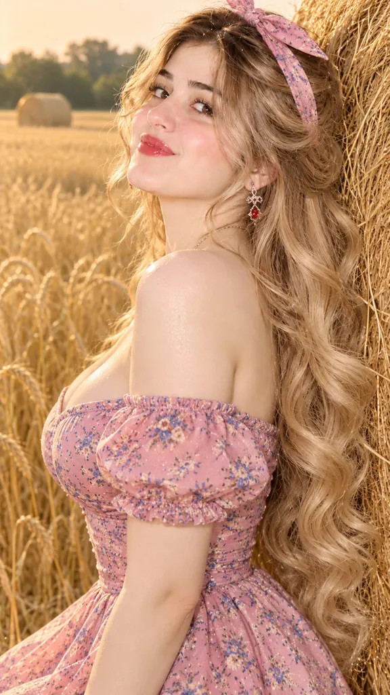

# Golden Hour Portrait by a Hay Bale — by @xnouraya

[← Back to Community Examples](../../EXAMPLES.md) · Category: Photography · Model: `Nano Banana Pro`

<a href="https://x.com/xnouraya/status/2125216502999904585"></a>

Source: **[@xnouraya on X](https://x.com/xnouraya/status/2125216502999904585)** · Creator: [Nouraya AI](https://x.com/xnouraya)

## Prompt

```text
A warm, ultra-realistic vertical portrait (9:16) of a young woman leaning back against a large round hay bale in a golden wheat field at late-afternoon golden hour. She is framed from the waist up in a relaxed, slightly angled pose, with her shoulder against the straw and her head tilted back and up. She gazes toward the camera with a soft, dreamy, sultry expression, with her lips slightly parted in a muted rose tone.

Subject and styling: She has long, silky, chestnut-brown hair with warm caramel highlights, parted off-center and falling straight over her shoulders. A vintage-style dusty-pink bandana with a small floral print is tied in a bow at the top of her head like a headband. Her eyes are bright aqua-blue, with defined lashes, soft peach eyeshadow and shaped brows. Her skin is fair and glowing with a natural, sun-kissed flush, a dewy finish and a few tiny droplets of moisture on her shoulder and chest, as if from a light summer mist.

Wardrobe: A romantic, rustic off-the-shoulder cottagecore sundress in soft blush pink with a delicate blue-and-cream ditsy floral print, a sweetheart neckline, gathered puff sleeves with elasticated edges, a fitted bodice and a flowing, gathered skirt.

Setting: An open countryside harvest field. The foreground and right of the frame are filled with the textured, golden strands of the hay bale, in extreme close detail. To the left, a sea of tall ripe wheat stretches into a softly blurred background, with a dark green tree line on the horizon and a pale, hazy peach sky. Another distant hay bale appears in soft bokeh.

Lighting: Warm, low golden-hour sunlight from the side and slightly behind, creating a soft glow on her skin, rim light along her hair and shoulder, and glowing highlights in the straw. Gentle, flattering shadows with a hazy, nostalgic atmosphere. Palette: honey gold, wheat yellow, dusty rose, chestnut brown and soft sage green, with a cool aqua accent in the eyes.

Camera and style: Shot on a full-frame camera with an 85mm lens at f/1.8, with a shallow depth of field, a sharp face and shoulder, and creamy background and foreground blur. Warm film-like color grading, fine grain, soft bloom, rich natural skin texture. Style: rustic countryside editorial, cottagecore, nostalgic harvest-season romance, dreamy and warm. 8K, highly detailed, photorealistic.
```

## Try it

Paste the prompt into **[vinano.ai](https://vinano.ai?utm_source=github&utm_medium=readme&utm_campaign=awesome-image-video-prompts-updating&utm_content=x-page-try)** to generate your own version.

> The image and prompt belong to @xnouraya ([original post](https://x.com/xnouraya/status/2125216502999904585)) and are shown here with credit for reference. Creators can ask for changes or removal by opening an issue.
