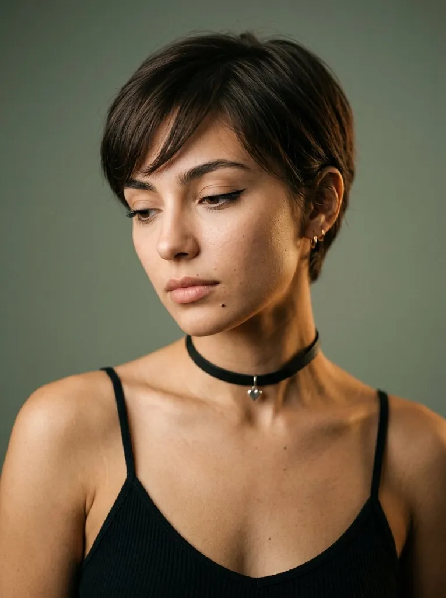

# Pixie Cut Studio Portrait — by @dreamydigiarts

[← Back to Community Examples](../../EXAMPLES.md) · Category: Photography · Model: `Nano Banana 2`

<a href="https://x.com/dreamydigiarts/status/2125182660406550918"></a>

Source: **[@dreamydigiarts on X](https://x.com/dreamydigiarts/status/2125182660406550918)** · Creator: [dreamy digital arts](https://x.com/dreamydigiarts)

## Prompt

```text
Ultra-realistic portrait of a young woman, short dark brown pixie haircut with soft side-swept bangs partially covering the forehead, natural olive skin, defined jawline, small beauty mark near the lips, subtle winged eyeliner, soft nude lips, elegant facial features, looking slightly downward with a calm and thoughtful expression.

Wearing a black fitted spaghetti-strap top and a black leather choker with a small heart pendant, small gold hoop earrings. No headband, no hair accessories.

Warm cinematic studio lighting, soft shadows, smooth green-gray background, shallow depth of field, highly detailed skin texture, photorealistic, professional fashion photography, 85mm lens, ultra sharp focus, realistic eyes, natural skin pores, high-end editorial portrait, 8k quality.
```

## Try it

Paste the prompt into **[vinano.ai](https://vinano.ai?utm_source=github&utm_medium=readme&utm_campaign=awesome-image-video-prompts-updating&utm_content=x-page-try)** to generate your own version.

> The image and prompt belong to @dreamydigiarts ([original post](https://x.com/dreamydigiarts/status/2125182660406550918)) and are shown here with credit for reference. Creators can ask for changes or removal by opening an issue.
