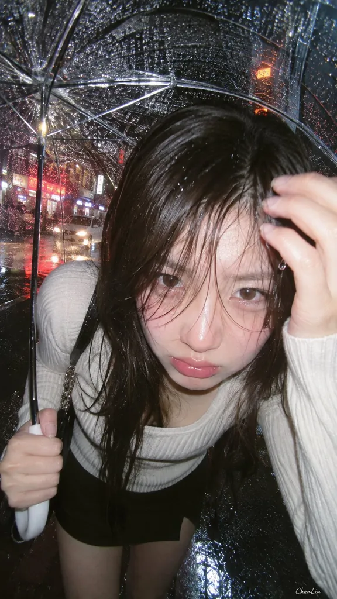

# Under the Clear Umbrella Flash Snapshot — by @chandrapie

[← Back to Community Examples](../../EXAMPLES.md) · Category: Photography · Model: `GPT Image 2.6`

<a href="https://x.com/chandrapie/status/2125116002061193365"></a>

Source: **[@chandrapie on X](https://x.com/chandrapie/status/2125116002061193365)** · Creator: [Chandra](https://x.com/chandrapie)

## Prompt

```text
9:16, an adult Korean-style beauty with a cool, sweet look, wearing a fitted white knit top and a black miniskirt, a rainy summer night in the city, 28mm ultra-wide angle, an extremely close-up couple’s-eye view, 2000s CCD direct flash.

The camera is positioned beneath a clear umbrella, with the foreground filled by the transparent plastic canopy, raindrops, and curved metal ribs.

The person was originally standing outside the umbrella, then suddenly bent down and ducked underneath to escape the rain, pressing their face right up against the lens.

Because of the extremely close distance, their face is naturally enlarged by the wide-angle lens, with one cheek almost touching the edge of the frame.

One hand grips the umbrella handle, while the other gently brushes aside rain-soaked bangs.

The person wears a slightly hurt, helpless expression, with lips slightly pursed and eyes looking straight into the lens.

Countless water droplets on the clear umbrella form a dense foreground, with the person’s face clearly visible through the gaps between the raindrops.

The background features wet city streets, neon signs, car lights, and blurred streaks of rain.

A palette of cool blue, deep black, and warm orange, with the CCD direct flash freezing the raindrops, natural facial highlights coexisting with localized overexposure.

An extremely close distance, a strong sense of visual enclosure, an imperfect candid shot, with the intimacy of a real couple sharing an umbrella.

One person in frame, an adult, with a tiny artistic handwritten “ChenLin” in the bottom-right corner.

n=5
```

## Try it

Paste the prompt into **[vinano.ai](https://vinano.ai?utm_source=github&utm_medium=readme&utm_campaign=awesome-image-video-prompts-updating&utm_content=x-page-try)** to generate your own version.

> The image and prompt belong to @chandrapie ([original post](https://x.com/chandrapie/status/2125116002061193365)) and are shown here with credit for reference. Creators can ask for changes or removal by opening an issue.
