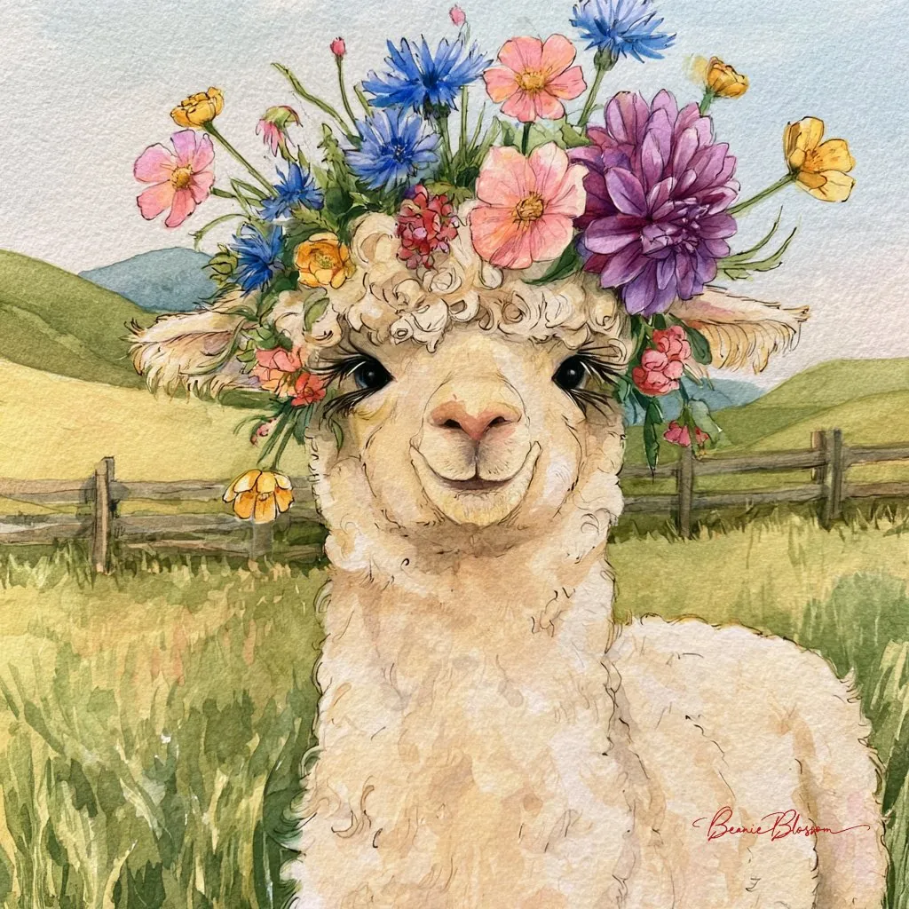

# Alpaca Crowned with Wildflowers — by @BeanieBlossom

[← Back to Community Examples](../../EXAMPLES.md) · Category: Illustration & 3D · Model: `Unknown`

<a href="https://x.com/BeanieBlossom/status/2124851469019144342"></a>

Source: **[@BeanieBlossom on X](https://x.com/BeanieBlossom/status/2124851469019144342)** · Creator: [Beanie Blossom](https://x.com/BeanieBlossom)

## Prompt

```text
An adorable young alpaca standing in a sunlit meadow after a rather enthusiastic encounter with a patch of wildflowers, its wonderfully fluffy head now decorated with an outrageous collection of colorful blossoms tangled in its wool. Bright cornflowers, pink cosmos, golden buttercups, and a single enormous purple dahlia stick out at wonderfully awkward angles, while the alpaca gazes straight ahead with a delightfully innocent expression, completely unaware of its spectacular new hairstyle. Its long eyelashes, slightly crooked ears, and soft curls give it an irresistibly endearing personality. Behind it, rolling green hills and a rustic wooden fence fade into the gentle afternoon sunshine. Charming watercolor and colored pencil illustration with delicate ink accents, vibrant floral colors against soft creamy wool, beautifully textured paper, expressive animal portrait, playful natural humor, warm and joyful countryside atmosphere, full of personality and delightful detail
```

## Try it

Paste the prompt into **[vinano.ai](https://vinano.ai?utm_source=github&utm_medium=readme&utm_campaign=awesome-image-video-prompts-updating&utm_content=x-page-try)** to generate your own version.

> The image and prompt belong to @BeanieBlossom ([original post](https://x.com/BeanieBlossom/status/2124851469019144342)) and are shown here with credit for reference. Creators can ask for changes or removal by opening an issue.
