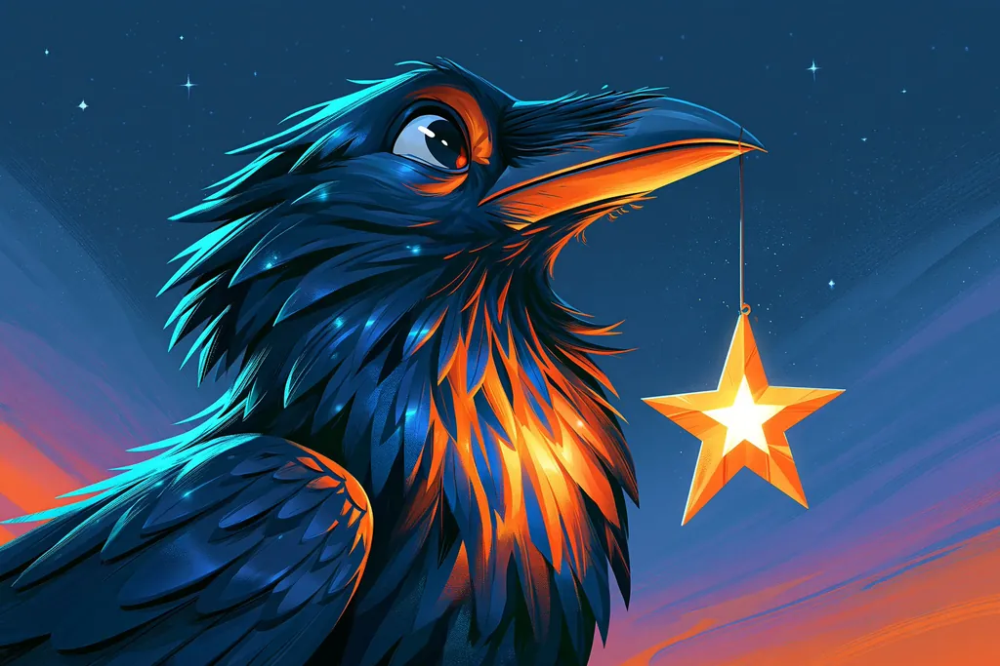

# Raven Holding a Glowing Star — by @heathergreen

[← Back to Community Examples](../../EXAMPLES.md) · Category: Illustration & 3D · Model: `Midjourney`

<a href="https://x.com/heathergreen/status/2125243046078136352"></a>

Source: **[@heathergreen on X](https://x.com/heathergreen/status/2125243046078136352)** · Creator: [Heather Green](https://x.com/heathergreen)

## Prompt

```text
A digital painting of a raven in profile, facing left, set against a twilight sky with soft deep indigo and magenta hues. The raven has dark, iridescent feathers with highlights of blue light reflecting off its plumage. It holds a glowing, five-pointed star by a thin string in its beak. The star emits a bright, warm light that illuminates the bird's chest and beak. The background features a starry night sky, creating a mystical and ethereal atmosphere. --ar 3:2 --raw --sref 1797736231 4192983240 --stylize 300 --hd
```

## Try it

Paste the prompt into **[vinano.ai](https://vinano.ai?utm_source=github&utm_medium=readme&utm_campaign=awesome-image-video-prompts-updating&utm_content=x-page-try)** to generate your own version.

> The image and prompt belong to @heathergreen ([original post](https://x.com/heathergreen/status/2125243046078136352)) and are shown here with credit for reference. Creators can ask for changes or removal by opening an issue.
