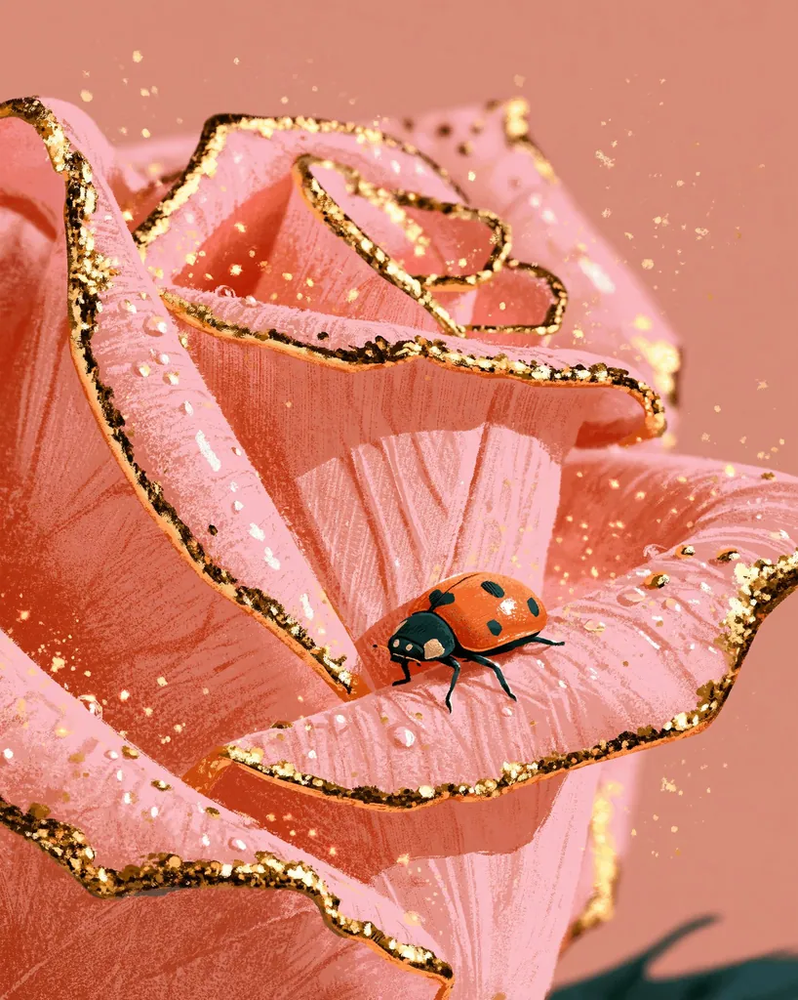

# Gold-Edged Peach Rose with Ladybug — by @heathergreen

[← Back to Community Examples](../../EXAMPLES.md) · Category: Illustration & 3D · Model: `Midjourney`

<a href="https://x.com/heathergreen/status/2125363850060951662"></a>

Source: **[@heathergreen on X](https://x.com/heathergreen/status/2125363850060951662)** · Creator: [Heather Green](https://x.com/heathergreen)

## Prompt

```text
An elegant peach rose edged with delicate gold leaf, a tiny ladybug perched on one velvety petal, rendered as a refined fantasy illustration. Luminous dewdrops, glossy petal surfaces, and glowing sparkling particles shimmer in the air; whimsical enchanted nature, intricate botanical detail, soft golden rim light, dreamy pastel palette, graceful close-up composition. --ar 4:5 --raw --sref 641174673 1673404755 2850100206 --stylize 300 --hd
```

## Try it

Paste the prompt into **[vinano.ai](https://vinano.ai?utm_source=github&utm_medium=readme&utm_campaign=awesome-image-video-prompts-updating&utm_content=x-page-try)** to generate your own version.

> The image and prompt belong to @heathergreen ([original post](https://x.com/heathergreen/status/2125363850060951662)) and are shown here with credit for reference. Creators can ask for changes or removal by opening an issue.
