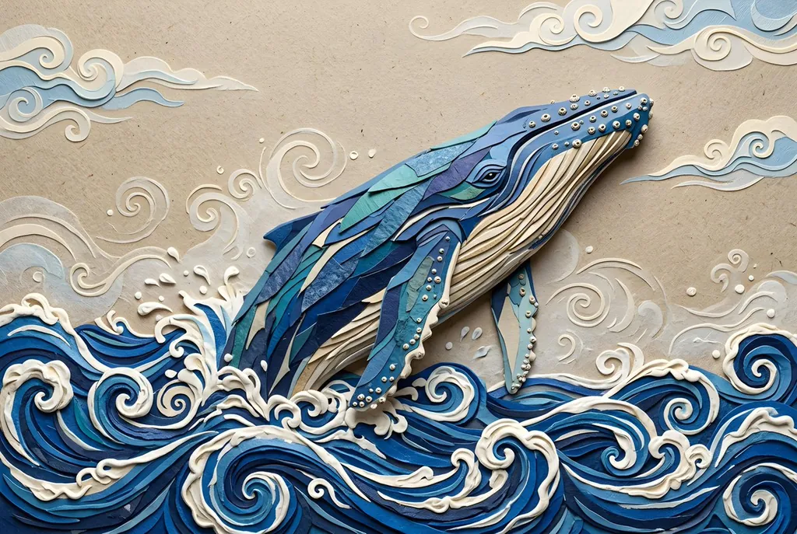

# Paper Relief Humpback Whale — by @heathergreen

[← Back to Community Examples](../../EXAMPLES.md) · Category: Illustration & 3D · Model: `Nano Banana 2.1`

<a href="https://x.com/heathergreen/status/2125212858132615239"></a>

Source: **[@heathergreen on X](https://x.com/heathergreen/status/2125212858132615239)** · Creator: [Heather Green](https://x.com/heathergreen)

## Prompt

```text
A textured, relief-style illustration depicting a humpback whale breaching from stylized, swirling ocean waves. The whale is composed of layered, mosaic-like blue and cream-colored paper or clay segments, giving it a three-dimensional, tactile appearance. The waves below are rendered in thick, impasto-style strokes of white and deep blue, creating a sense of dynamic motion and foam.
```

## Try it

Paste the prompt into **[vinano.ai](https://vinano.ai?utm_source=github&utm_medium=readme&utm_campaign=awesome-image-video-prompts-updating&utm_content=x-page-try)** to generate your own version.

> The image and prompt belong to @heathergreen ([original post](https://x.com/heathergreen/status/2125212858132615239)) and are shown here with credit for reference. Creators can ask for changes or removal by opening an issue.
