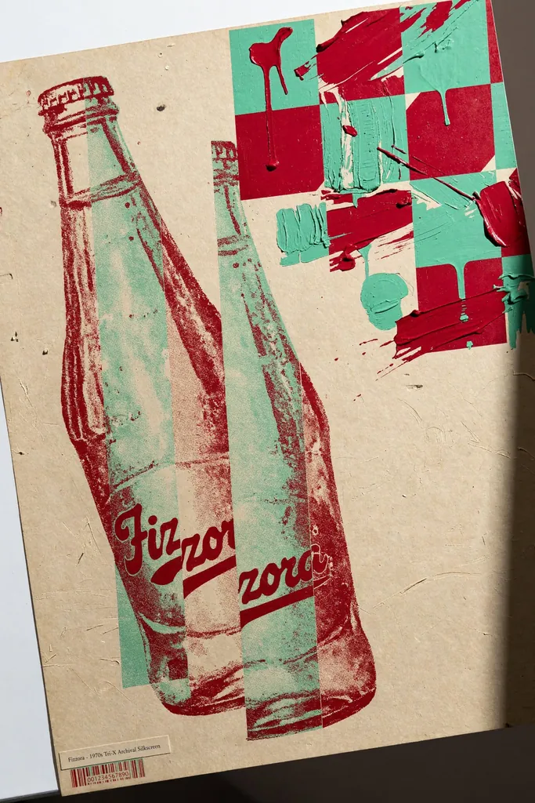

# Spliced Silkscreen Product Art — by @seirdotmk

[← Back to Community Examples](../../EXAMPLES.md) · Category: Product & Brand · Model: `MiniMax H3 Image`

<a href="https://x.com/seirdotmk/status/2124941050326499351"></a>

Source: **[@seirdotmk on X](https://x.com/seirdotmk/status/2124941050326499351)** · Creator: [Myron AI artist](https://x.com/seirdotmk)

## Prompt

```text
[SUBJECT] manifested through a spliced silkscreen combine, where a vintage archival photograph is screen-printed in two flat overprinted inks, sliced into offset vertical strips that swap which ink carries the shadows, and dissolves along one edge into a grid of square canvas panels loaded with gestural abstract-expressionist brushwork that echoes the subject's contours. Employ [COLOR1] and [COLOR2] to split the subject into alternating tonal halves that trade places strip by strip.
```

## Try it

Paste the prompt into **[vinano.ai](https://vinano.ai?utm_source=github&utm_medium=readme&utm_campaign=awesome-image-video-prompts-updating&utm_content=x-page-try)** to generate your own version.

> The image and prompt belong to @seirdotmk ([original post](https://x.com/seirdotmk/status/2124941050326499351)) and are shown here with credit for reference. Creators can ask for changes or removal by opening an issue.
