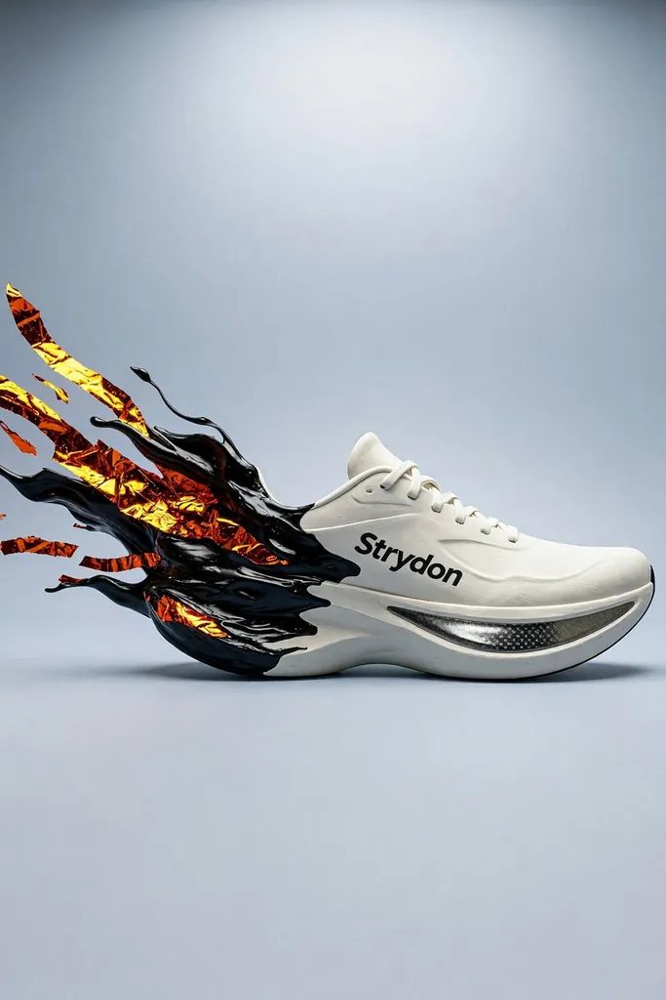

# Velocity Smear Product Sculpture — by @seirdotmk

[← Back to Community Examples](../../EXAMPLES.md) · Category: Product & Brand · Model: `MiniMax H3 Image`

<a href="https://x.com/seirdotmk/status/2125122247815786746"></a>

Source: **[@seirdotmk on X](https://x.com/seirdotmk/status/2125122247815786746)** · Creator: [Myron AI artist](https://x.com/seirdotmk)

## Prompt

```text
[SUBJECT] manifested through a velocity smear, where the front of the product is sculpted in smooth matte clay while its rear half tears backward into windswept ribbons of glossy black paint and shards of metallic leaf, as if the object is being stripped apart by its own speed. Employ [COLOR1] and [COLOR2] to separate the calm sculpted face from the metallic fragments tracing the direction of motion.
```

## Try it

Paste the prompt into **[vinano.ai](https://vinano.ai?utm_source=github&utm_medium=readme&utm_campaign=awesome-image-video-prompts-updating&utm_content=x-page-try)** to generate your own version.

> The image and prompt belong to @seirdotmk ([original post](https://x.com/seirdotmk/status/2125122247815786746)) and are shown here with credit for reference. Creators can ask for changes or removal by opening an issue.
