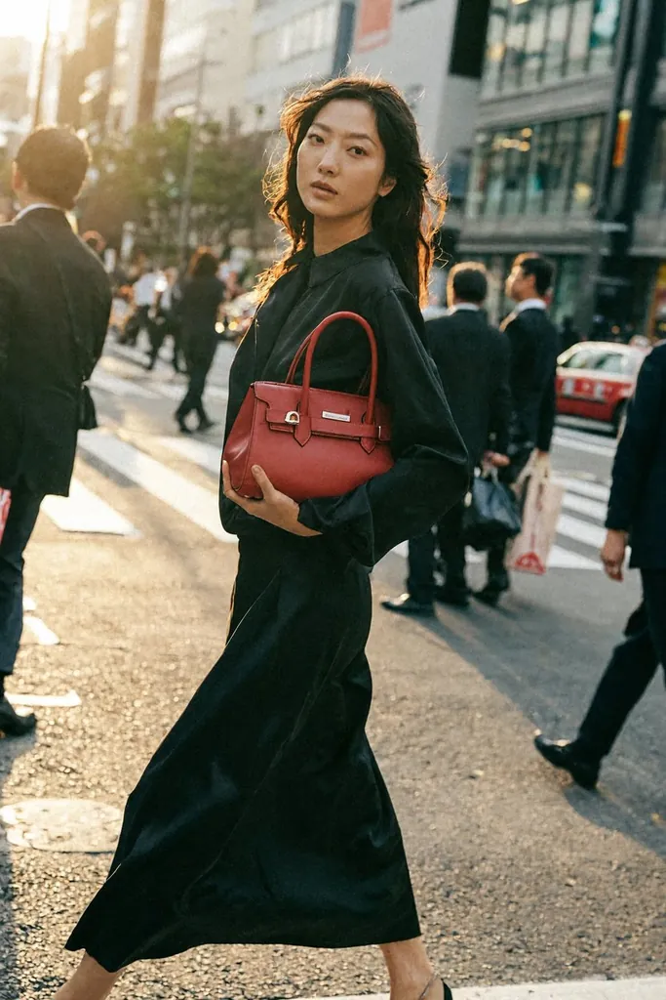

# Telephoto Candid Product Street Shot — by @seirdotmk

[← Back to Community Examples](../../EXAMPLES.md) · Category: Product & Brand · Model: `MiniMax H3 Image`

<a href="https://x.com/seirdotmk/status/2125318285260644519"></a>

Source: **[@seirdotmk on X](https://x.com/seirdotmk/status/2125318285260644519)** · Creator: [Myron AI artist](https://x.com/seirdotmk)

## Prompt

```text
[SUBJECT] manifested through a telephoto candid, where the product is carried through a crowded city crosswalk at golden hour by a walker in a monochrome outfit, and a long lens compresses the rush-hour crowd into soft blur so that only the walker and the product stay sharp, like an unplanned street-style shot on 35mm film. Employ [COLOR1] and [COLOR2] to keep the outfit quiet and let the product echo one distant street accent.
```

## Try it

Paste the prompt into **[vinano.ai](https://vinano.ai?utm_source=github&utm_medium=readme&utm_campaign=awesome-image-video-prompts-updating&utm_content=x-page-try)** to generate your own version.

> The image and prompt belong to @seirdotmk ([original post](https://x.com/seirdotmk/status/2125318285260644519)) and are shown here with credit for reference. Creators can ask for changes or removal by opening an issue.
