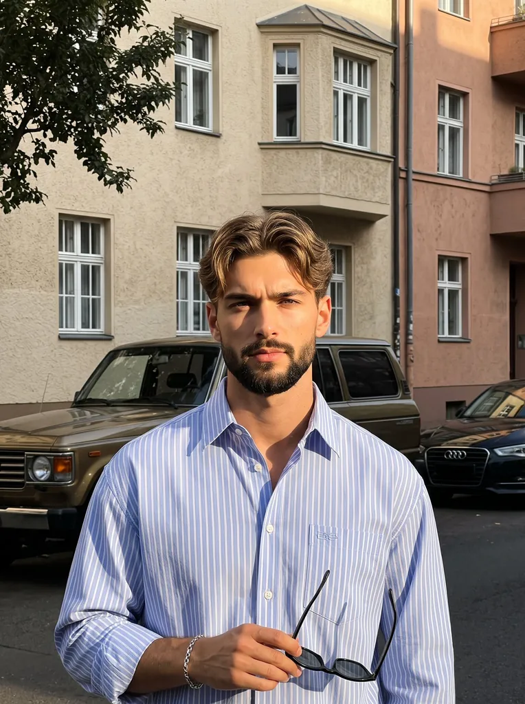

# European Street Menswear Portrait — by @pictsbyai

[← Back to Community Examples](../../EXAMPLES.md) · Category: Photography · Model: `Nano Banana 2.1`

<a href="https://x.com/pictsbyai/status/2125141872859631950"></a>

Source: **[@pictsbyai on X](https://x.com/pictsbyai/status/2125141872859631950)** · Creator: [Picts by AI](https://x.com/pictsbyai)

## Prompt

```text
A medium-scale, centered portrait captures a young adult male with golden tan skin (#C8845A) and a chiseled jawline standing on an outdoor European residential street, facing the camera with a slight angle and relaxed shoulders tilted slightly down on the left. His ash blonde brown (#6E563B) hair is styled in a middle-parted curtain flow cut, cropped near the upper ears with 3-4 inch wavy top layers swept back, showing natural strand separation, matte finish, golden highlights, and slight crown flyaways. He wears a posed, confident expression with neutral relaxed closed lips, slightly furrowed eyebrows, and a direct intense gaze squinting slightly against the sun. He is dressed in an oversized periwinkle ice blue (#B5C2D8) and white vertical striped button-down cotton shirt featuring a subtle bold sans-serif embroidered brand logo below the left chest pocket, while his relaxed left hand, adorned with a silver link chain bracelet, rests at bottom center with fingers gently curled around the bridge and lens rim of black-framed oval sunglasses at waist level. Behind him in the midground sits a vintage pristine boxy Land Cruiser-style SUV with glossy olive-brown paint, dark tinted windows, and a chrome front grille edge, alongside a pristine black Audi sedan with its four-ring grille emblem at middle right and a thriving deciduous tree branch with shadowed dark green leaves in the top left corner. The deep background features aged residential multi-story apartment buildings with matte rough pebbled stucco plaster over masonry—warm cream beige on the left and warm terracotta blush (#C5A898) on the right—detailed with recessed multi-pane white casement windows, white muntin bars, a bay window overhang, and a dark vertical downspout pipe. A single low-angle natural golden hour sun source from a 45-degree side angle at camera left casts bright, hard, highly directional light and high-contrast deep black (#2A261B) long shadows with harsh defined edges across his left eye socket, right cheek, under the chin, and right chest, balanced by warm ambient bounce off the facades and preserved highlights along his forehead, nose bridge, right cheekbone, hair waves, and right shoulder. Shot straight-on as a tack-sharp digital photograph using a 35mm or 50mm lens at f/4.0, 1/1000s, and ISO 100 with a medium depth of field, European summer menswear editorial aesthetics, warm color grading, crushed shadow blacks, and subtle skin highlight roll-off, framed in a 3:4 vertical portrait aspect ratio.
```

## Try it

Paste the prompt into **[vinano.ai](https://vinano.ai?utm_source=github&utm_medium=readme&utm_campaign=awesome-image-video-prompts-updating&utm_content=x-page-try)** to generate your own version.

> The image and prompt belong to @pictsbyai ([original post](https://x.com/pictsbyai/status/2125141872859631950)) and are shown here with credit for reference. Creators can ask for changes or removal by opening an issue.
