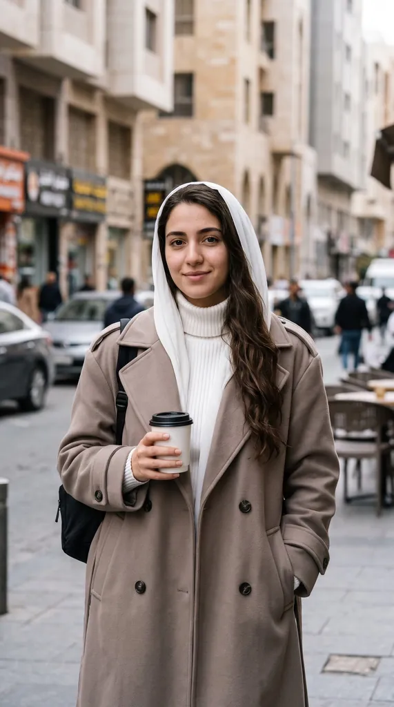

# Street Fashion Portrait in an Arab City — by @Faeiz4Ai

[← Back to Community Examples](../../EXAMPLES.md) · Category: Photography · Model: `Nano Banana 2.1`

<a href="https://x.com/Faeiz4Ai/status/2125124006202200455"></a>

Source: **[@Faeiz4Ai on X](https://x.com/Faeiz4Ai/status/2125124006202200455)** · Creator: [FAEIZ](https://x.com/Faeiz4Ai)

## Prompt

```text
Create an ultra-photorealistic professional street-fashion photograph of a young adult Arab woman standing naturally on a lively modern Arab city street.

A young woman with naturally beautiful Arab facial features, fair natural skin, expressive brown eyes, and long, wavy dark-brown hair falling over her shoulders. She wears a simple white headscarf, with a calm expression and a subtle natural smile, looking toward the camera.

She wears an elegant oversized taupe-beige double-breasted trench coat with wide classic lapels, structured shoulders, and visible buttons. Underneath, a thick white ribbed turtleneck sweater. A black backpack strap rests naturally over one shoulder.

She stands comfortably with a relaxed posture, holding a white takeaway coffee cup with a lid in one hand while her other hand rests inside her coat pocket.

The setting is a lively contemporary Arab city street featuring modern Arabic-inspired architecture, authentic local storefronts, urban buildings, and naturally moving pedestrians in the background, creating a believable everyday urban atmosphere.

Vertical 9:16 composition, medium-length portrait framed from mid-thigh upward, front-facing eye-level camera angle, centrally positioned subject, natural perspective, and professional editorial street-fashion photography.

Soft natural daylight, realistic skin pores, intricate facial details, individually defined hair strands, authentic fabric textures, natural clothing folds, physically accurate shadows, shallow depth of field, and beautifully controlled optical background blur.

Apply seven essential photorealism principles: professional full-frame camera aesthetics, authentic 85mm lens perspective, lifelike skin texture, precise material details, realistic urban atmosphere, natural optical bokeh, and physically accurate lighting.

Optimize specifically for Nano Banana 2.1, prioritizing exceptional micro-details, authentic colors, accurate anatomy, natural proportions, and cinematic photographic realism.

The final image must be indistinguishable from genuine professional photography, with premium fashion editorial quality.

No CGI appearance, no artificial skin, no excessive beauty retouching, no distorted anatomy, no extra fingers, no artificial lighting effects, no text, no logos, and no watermarks.
```

## Try it

Paste the prompt into **[vinano.ai](https://vinano.ai?utm_source=github&utm_medium=readme&utm_campaign=awesome-image-video-prompts-updating&utm_content=x-page-try)** to generate your own version.

> The image and prompt belong to @Faeiz4Ai ([original post](https://x.com/Faeiz4Ai/status/2125124006202200455)) and are shown here with credit for reference. Creators can ask for changes or removal by opening an issue.
